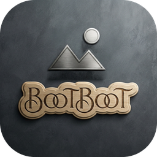
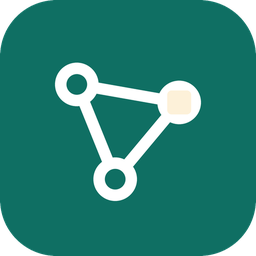
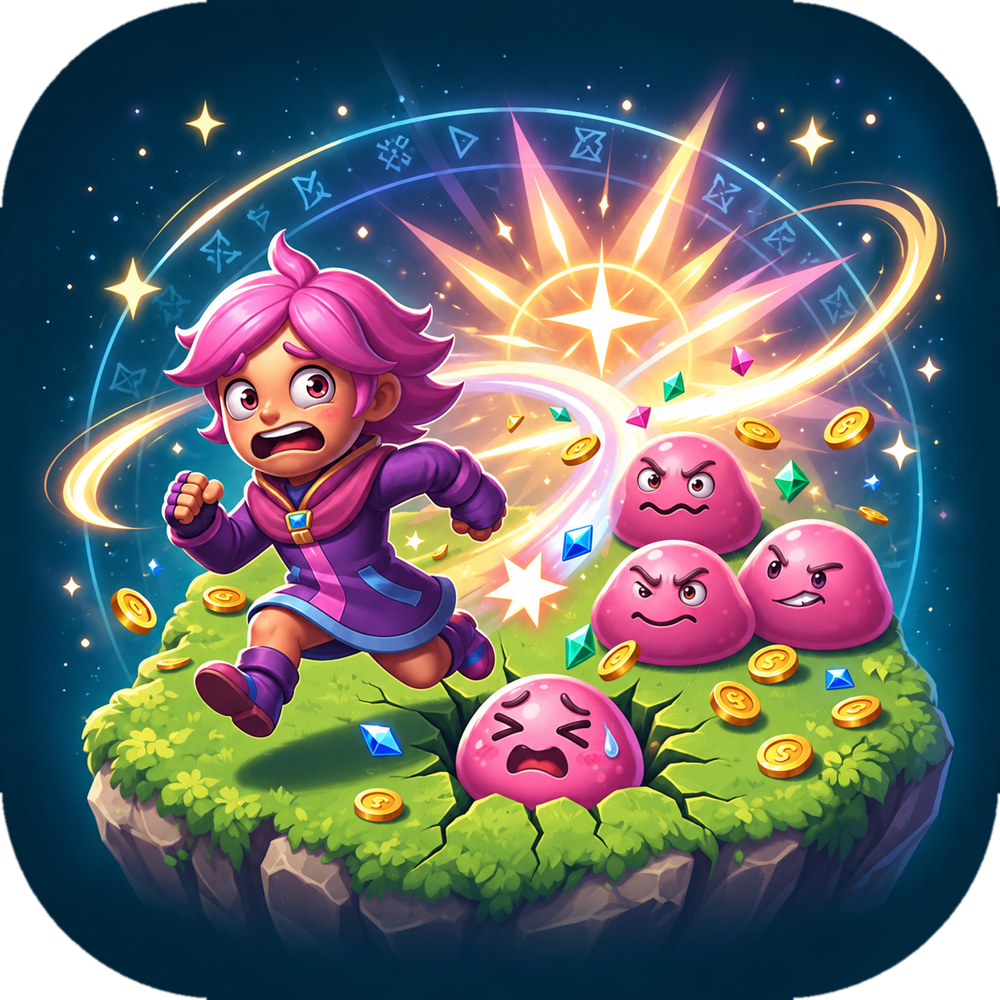
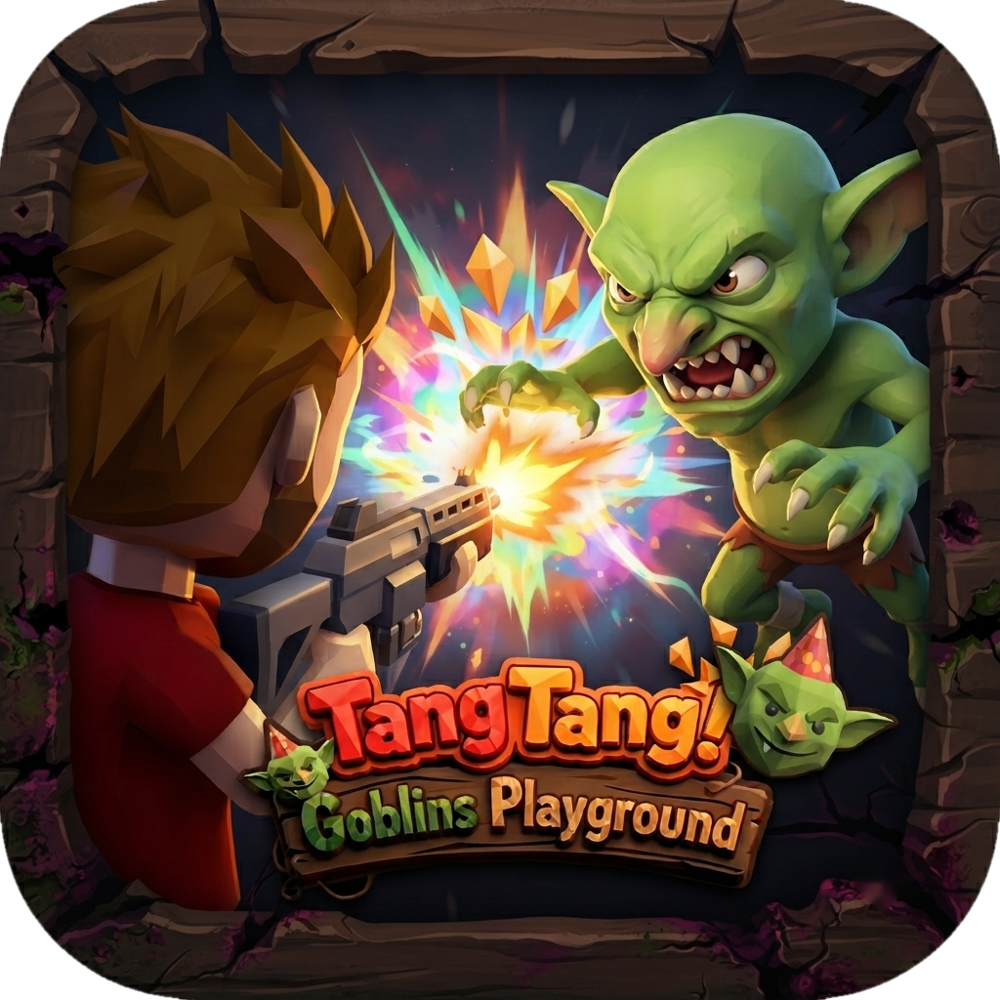
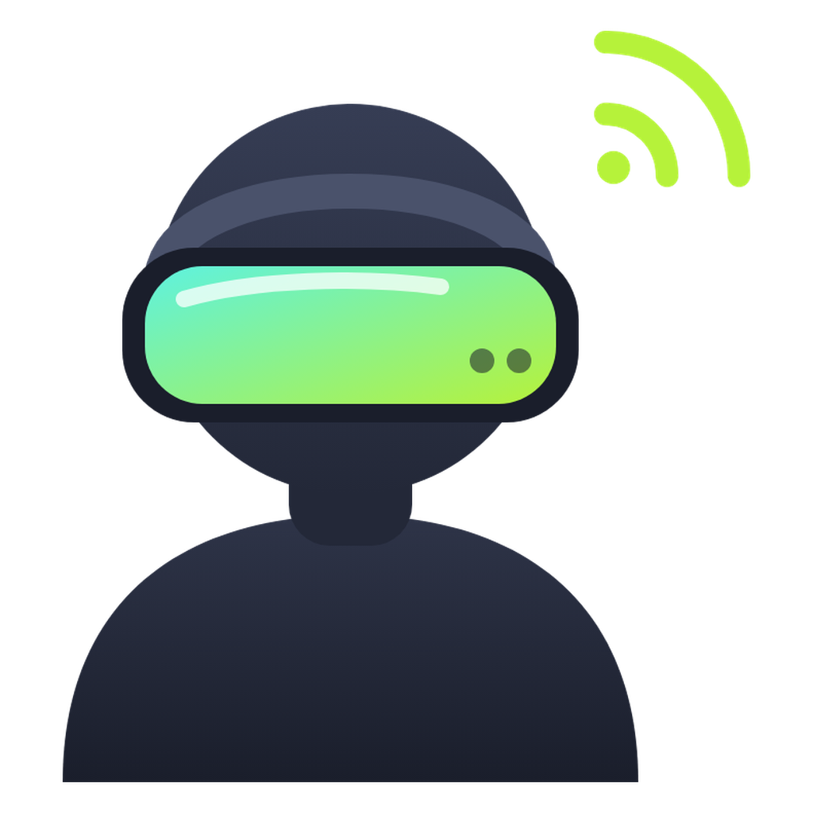
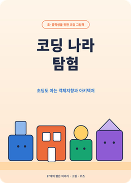

        

  
    
<code>I just started to lean C, C#, java, little bit C++.</code>
 
<code>I experienced an interesting world👀</code>
 
 
<code>Erasing and rebuilding, erasing and rebuilding,</code>
 
<code>repeatedly organizings are my hobby.🫨</code>

    

## 🌐 웹앱

| |제목|설명|
|---|---|---|
||[URURU](https://app-ururu.pages.dev/)|스와이프로 친구를 만나고 바로 채팅하는 소셜 웹앱|
||[C Master](https://app-c-master.itsjinmi.workers.dev/)|C언어 학습 웹앱|
||[BootBoot](https://app-collage-bootboot.pages.dev/)|사진 콜라주 웹앱|
||[Tangle](https://tanglee.netlify.app/)|다이어그램 툴|

## 🎮 게임

| |제목|설명|
|---|---|---|
||[Runny Bunny](https://play.google.com/store/apps/details?id=com.developerMJ.BunnyRunning)|2D Side Scrolling 게임 (Google Play)|
||[RUNIT](https://play.google.com/store/apps/details?id=com.Runit.myapp)|Dodge 3D 게임 (Google Play)|
||[TangTang Goblin Playground](https://gamejolt.com/games/tps-goblin/1108802)|몰려오는 고블린을 공격하는 TPS게임 (GameJolt)|

##  게임

| |제목|설명|
|---|---|---|
||[VR Bowling](https://gamejolt.com/games/vr-bowling/1108572)|공을 손으로 잡고 던지는 VR 볼링 게임 (GameJolt)|
||[VR Beat Sync](https://gamejolt.com/games/VRBeatSync/1112300)|박자에 맞춰 날아오는 노트를 광선검으로 베는 VR 리듬 게임 (GameJolt)|

## 📚 교재

| |제목|설명|
|---|---|---|
||코딩나라 탐험|초·중학생을 위한 프로그래밍 교재 — 개인적으로 공부했던 내용을 교재로 제작|

    
