# guideMermaid
> 기획서에 그림이 필요할 때 이 파일에서 **질문에 맞는 틀**을 골라 복사해 쓰세요.
> 글자(코드)로 적으면 GitHub · VS Code 미리보기(`Markdown Preview Mermaid Support` 확장)에서 그림으로 보여요.
> ⭐ = 지금 게임 기획서(`docs/Proposal`)에서 쓰고 있는 틀

---

## 어떤 그림을 쓸까? (질문 → 틀)

| 이런 걸 설명하고 싶을 때 | 쓰는 틀 | 번호 |
|---|---|---|
| 어떤 **순서**로 일어나나? 조건에 따라 **갈라지나**? | ⭐ 흐름도 | [1](#1-흐름도--flowchart-td) |
| 무엇이 무엇과 **연결**되나? 누가 누구에게 **알리나**? | ⭐ 구성도 | [2](#2-구성도--flowchart-lr--층) |
| 이런 **예외 상황**이면 어떻게 되나? | ⭐ 예외 처리 지도 | [3](#3-예외-처리-지도) |
| 지금 어떤 **상태**이고 언제 **바뀌나**? 화면 전환은? | ⭐ 상태도 | [4](#4-상태도--statediagram-v2) |
| **언제 · 얼마 동안** 일어나나? | ⭐ 타임라인 | [5](#5-타임라인--gantt) |
| 시간에 따라 값이 **어떻게 변하나**? | ⭐ 선그래프 | [6](#6-선그래프--xychart-beta-line) |
| 숫자가 **얼마나** 다른가? | ⭐ 막대그래프 | [7](#7-막대그래프--xychart-beta-bar) |
| 전체 중 **몇 %**인가? | ⭐ 원그래프 | [8](#8-원그래프--pie) |
| 핵심을 **한눈에** 요약 | ⭐ 마인드맵 | [9](#9-마인드맵--mindmap) |
| 스크립트끼리 **시간 순서대로** 주고받는 호출 (개발자용) | 시퀀스 다이어그램 | [10](#10-시퀀스-다이어그램--sequencediagram) |
| 클래스 **상속 · 구조** (개발자용) | 클래스 다이어그램 | [11](#11-클래스-다이어그램--classdiagram) |
| 저장 데이터 · 표의 **관계** | ER 다이어그램 | [12](#12-er-다이어그램--erdiagram) |
| 플레이어가 단계마다 **어떤 기분**인가? | 사용자 여정 | [13](#13-사용자-여정--journey) |
| 할 일의 **우선순위** (효과 vs 비용) | 우선순위 매트릭스 | [14](#14-우선순위-매트릭스--quadrantchart) |
| **개발 일정 · 버전** 흐름 | 연대표 | [15](#15-연대표--timeline) |
| git **브랜치 · 병합** 흐름 | 깃 그래프 | [16](#16-깃-그래프--gitgraph) |
| 무기 · 캐릭터 **능력치**를 여러 항목으로 비교 | 레이더 차트 | [17](#17-레이더-차트--radar-beta) |


# Mermaid 방향 설정 (TD · LR · RL · BT)
| 그림 종류 | `TD` · `LR` · `RL` · `BT` 적용 | 쓰는 법 |
|---|---|---|
| `flowchart` (흐름도 · 구성도) | ✅ | `flowchart LR` |
| `subgraph` (묶음 상자 안) | ✅ | `direction LR` |
| `stateDiagram-v2` (상태도) | ✅ | `direction LR` |
| `classDiagram` (클래스도) | ✅ | `direction LR` |
| `erDiagram` (DB 관계도) | ✅ | `direction LR` |
| `xychart-beta` (막대 · 선그래프) | ❌ (`horizontal`로 가로만 가능) | `xychart-beta horizontal` |


### 이 프로젝트의 공통 규칙
- 그림 위에 `**[종류] 제목**`, 그림 아래에 `> 읽는 법: …` 한 줄
- 숫자 비교가 **현재 vs 제안**처럼 범례가 필요하면 그래프 대신 **표**
- 위치 · 모양(옆 · 위에서 본 모습)은 Mermaid로 못 그려서 **글자 그림**

---

## 1. 흐름도 — `flowchart TD`
⭐ 사용 중 · 순서와 조건 분기. 색 = 종류, 아이콘 = 종류.

| 모양 | 쓰는 법 | 뜻 |
|---|---|---|
| 초록 둥근 상자 | `id(["▶ 글"]):::start` | 시작 · 입력 |
| 파랑 상자 | `id["⚙️ 글"]:::proc` | 처리 |
| 빨강 상자 | `id["✏️ 글"]:::data` | 값 변경 |
| 주황 마름모 | `id{"글?"}:::dec` | 판단 (Y / N) |
| 보라 평행사변형 | `id[/"📢 글"/]:::io` | 출력 (소리 · 화면) |
| 회색 둥근 상자 | `id(["⏹ 글"]):::endc` | 끝 · 무시 |

**[흐름도] 제목**
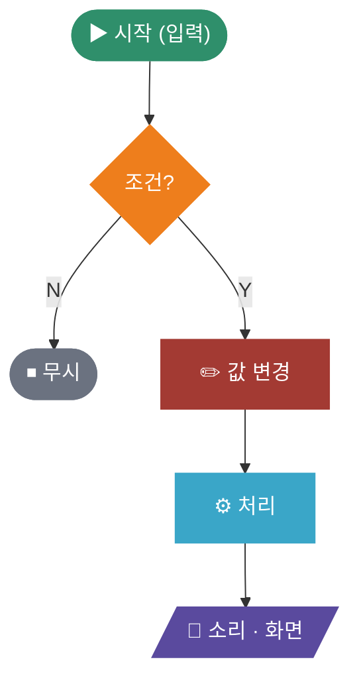
> 읽는 법: 초록에서 시작해 화살표를 따라 내려가요. 주황 마름모에서 Y(예) / N(아니오)으로 갈라져요.

**여러 상황을 한 그림에** (① 누름 · ② 뗌처럼)
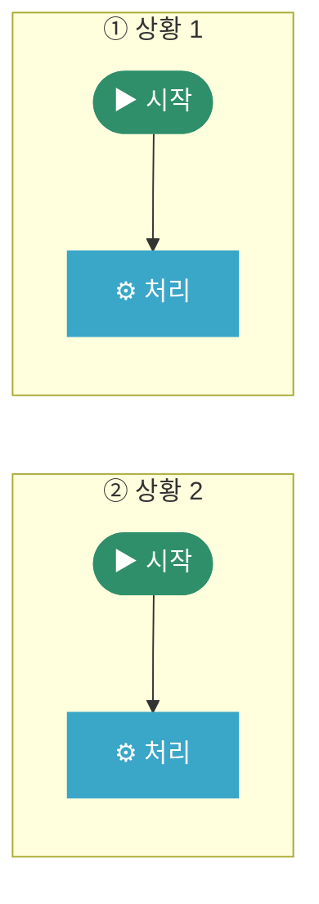

---

## 2. 구성도 — `flowchart LR` + 층
⭐ 사용 중 · 연결 · 신호. 상자를 **층(칸)**으로 묶고, 화살표에 이름, 순서는 ①②③.

| 색 · 아이콘 | 쓰는 법 | 뜻 |
|---|---|---|
| 초록 🎬 | `:::scene` | 씬 · 입력 |
| 파랑 📜 | `:::script` | 스크립트 |
| 회색 📦 | `:::obj` | 게임 오브젝트 |
| 보라 🖥️ | `:::ui` | 화면 · 소리 |
| 빨강 💾 | `:::data` | 데이터 · 저장 |

**[구성도] 제목**
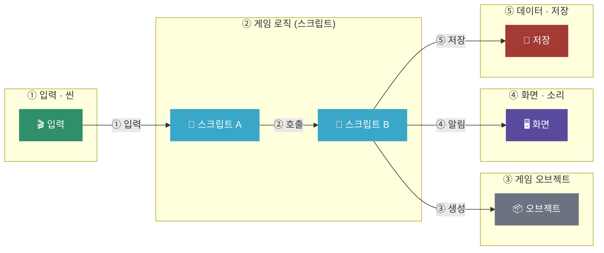
> 읽는 법: 상자 = 씬 · 스크립트 · 오브젝트, 화살표 위 글 = 보내는 신호나 하는 일이에요. ①②③은 일어나는 순서예요.

---

## 3. 예외 처리 지도
⭐ 사용 중 · "이런 상황이면 → 지금 이렇게 동작" 목록을 그림으로. 원래 예외 처리 **표는 아래에 그대로** 둬요.

**[구성도] 예외 처리 지도 — 기능 이름**
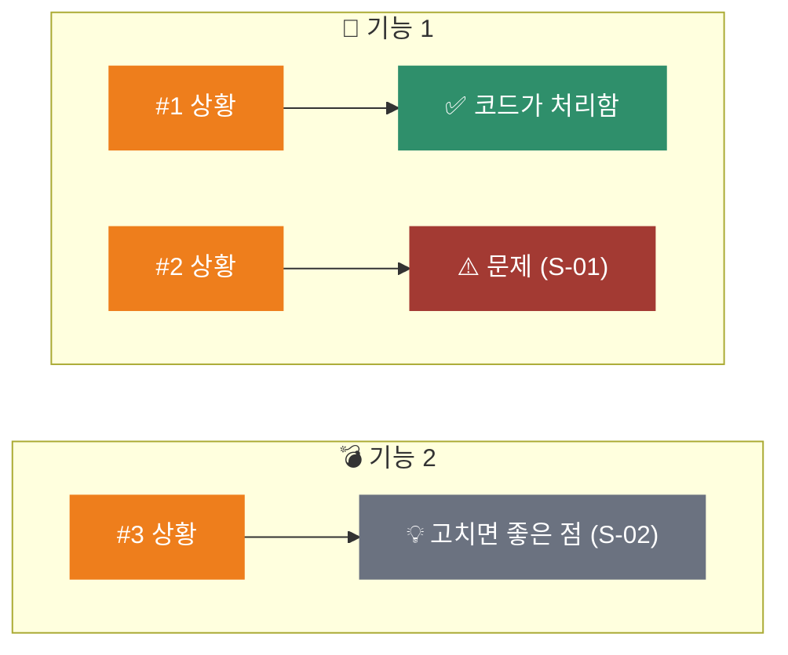
> 읽는 법: 주황 = 이런 상황이면? → 초록 ✅ 처리됨 / 빨강 ⚠️ 문제 / 회색 💡 개선. 괄호 = Suggestions 번호.

---

## 4. 상태도 — `stateDiagram-v2`
⭐ 사용 중 · 상태와 바뀌는 조건. 화면 전환(Intro → Play → GameOver)도 상태도로.

| 색 | 뜻 |
|---|---|
| 초록 `play` | 진행 중 |
| 파랑 `wait` | 대기 · 준비 |
| 빨강 `fail` | 실패 · 게임오버 |
| 회색 `stop` | 멈춤 |
| 보라 `done` | 결과 · 클리어 |

**[상태도] 제목**
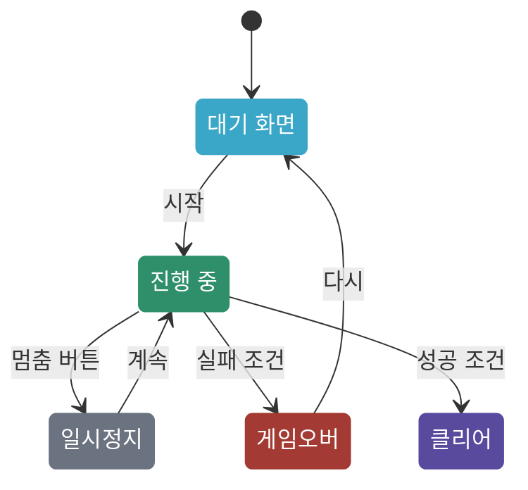
> 읽는 법: 상자 = 상태, 화살표 위 글 = 상태가 바뀌는 조건이에요. 검은 점에서 시작해요.

---

## 5. 타임라인 — `gantt`
⭐ 사용 중 · 언제 · 얼마 동안. `dateFormat x`(밀리초)로 쓰면 초 단위 게임 시간을 그릴 수 있어요.

| 쓰는 법 | 모양 |
|---|---|
| `이름 :id, 시작ms, 길이ms` | 막대 (이어지는 동안) |
| `:active, …` | 파란 강조 막대 |
| `:crit, …` | 빨간 막대 (위험 · 못 움직임) |
| `이름 :milestone, id, 시각ms, 0ms` | 마름모 (그 순간) |

**[타임라인] 제목**
```mermaid
gantt
  title 제목
  dateFormat x
  axisFormat %S초
  section 줄 이름 1
  동작 A :active, a1, 0, 3000ms
  위험 구간 :crit, a2, 3000, 1500ms
  section 줄 이름 2
  어떤 순간 :milestone, m1, 2000, 0ms
```
> 읽는 법: 왼쪽 → 오른쪽이 시간이에요. 막대 = 이어지는 동안, 마름모 = 그 순간. 빨간 막대는 위험하거나 못 움직이는 시간이에요.

---

## 6. 선그래프 — `xychart-beta` line
⭐ 사용 중 · 시간에 따라 변하는 값 (궤적 · 누적). **선은 하나만**.

**[선그래프] 제목**
```mermaid
xychart-beta
  title "제목 (단위)"
  x-axis ["0초", "1초", "2초", "3초"]
  y-axis "값 이름" 0 --> 10
  line [0, 6, 9, 10]
```
> 읽는 법: 왼쪽 → 오른쪽이 시간, 위로 갈수록 값이 커요.

---

## 7. 막대그래프 — `xychart-beta` bar
⭐ 사용 중 · 크기 비교. **막대 한 종류만** (막대 + 선 섞지 않기).

**[막대그래프] 제목**
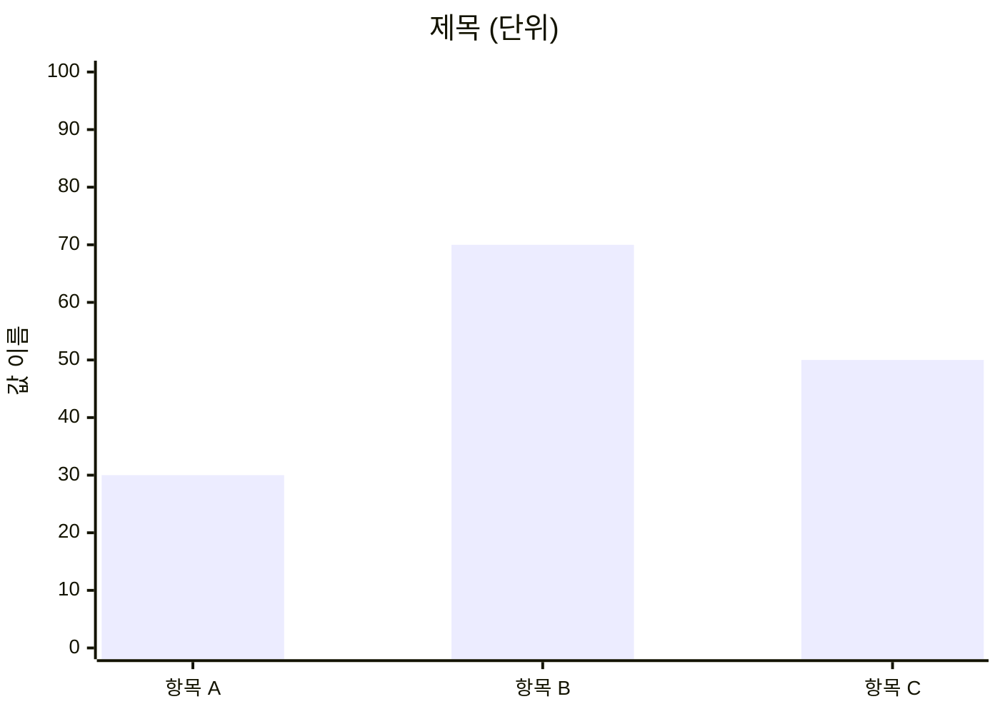
> 읽는 법: 막대가 높을수록 값이 커요.

---

## 8. 원그래프 — `pie`
⭐ 사용 중 · 전체 중 비율.

**[원그래프] 제목**
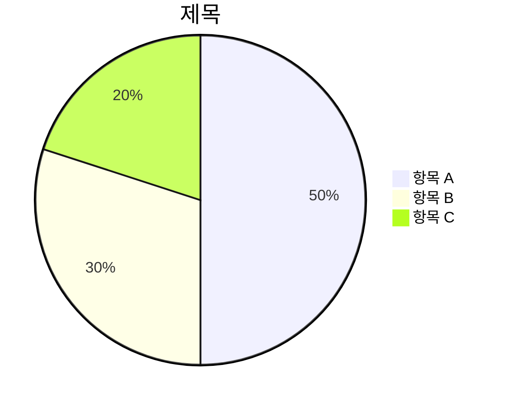
> 읽는 법: 조각이 클수록 비율이 커요.

---

## 9. 마인드맵 — `mindmap`
⭐ 사용 중 · 핵심 요약 (가운데 → 가지). 글에 `( ) [ ] { }`를 넣으면 모양으로 바뀌니 빼고 쓰세요.

**[마인드맵] 제목**
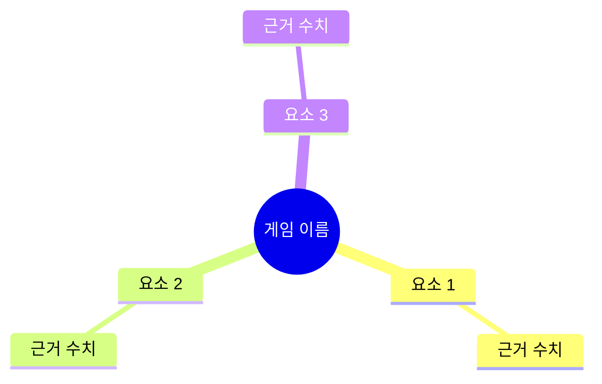
> 읽는 법: 가운데 = 주제, 가지 = 요소, 끝 = 근거예요.

---

## 10. 시퀀스 다이어그램 — `sequenceDiagram`
스크립트끼리 시간 순서대로 주고받는 호출. 개발자 문서에 좋지만, 기획 문서에서는 구성도가 더 읽기 쉬워요.

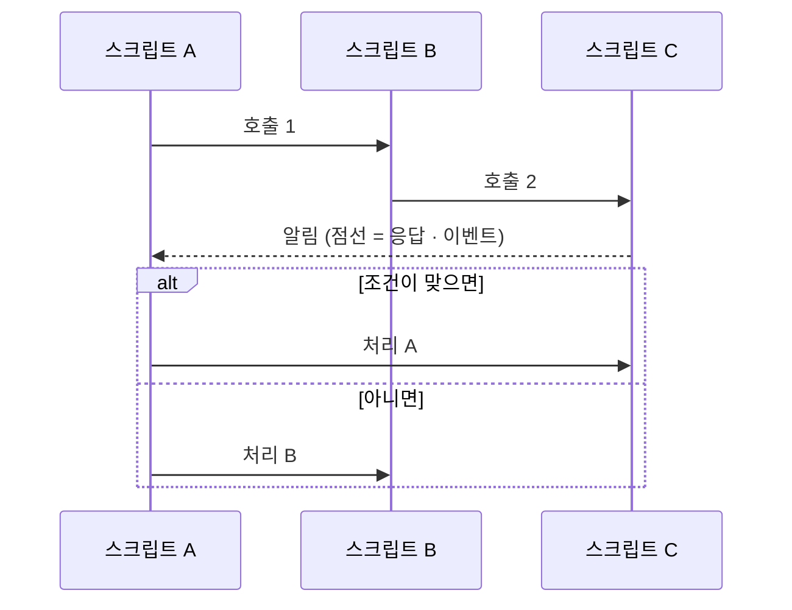

---

## 11. 클래스 다이어그램 — `classDiagram`
스크립트(클래스)의 상속 · 필드 · 함수 구조. 예: `LivingEntity` → `PlayerHealth`, `Goblin`.

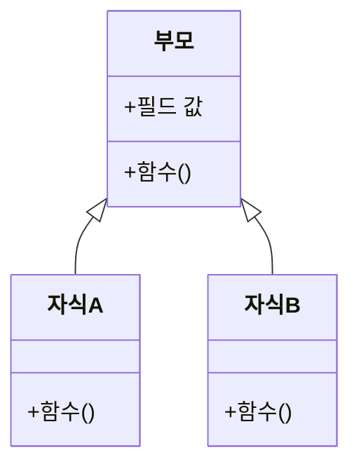

---

## 12. ER 다이어그램 — `erDiagram`
저장 데이터 · 표 사이 관계. 예: 랭킹 한 줄 = 판 하나, 곡 하나 = 악보 여러 개.

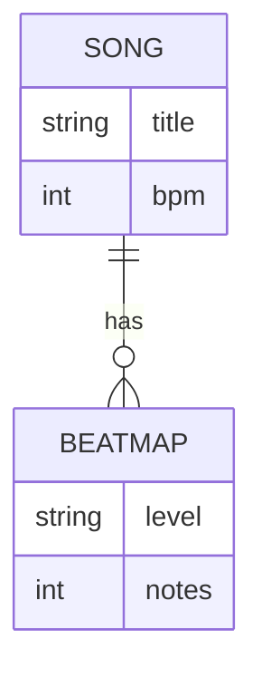

---

## 13. 사용자 여정 — `journey`
플레이어가 단계마다 느끼는 기분 (1 ~ 5점). 재미 · 이탈 지점 분석에 좋아요.

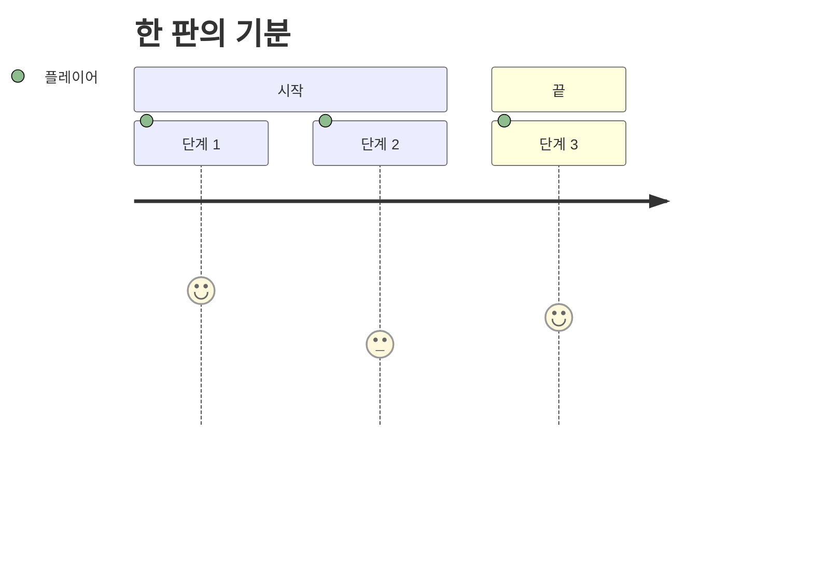

---

## 14. 우선순위 매트릭스 — `quadrantChart`
고칠 것 · 제안의 우선순위 (효과 vs 비용). Suggestions 정리에 좋아요.

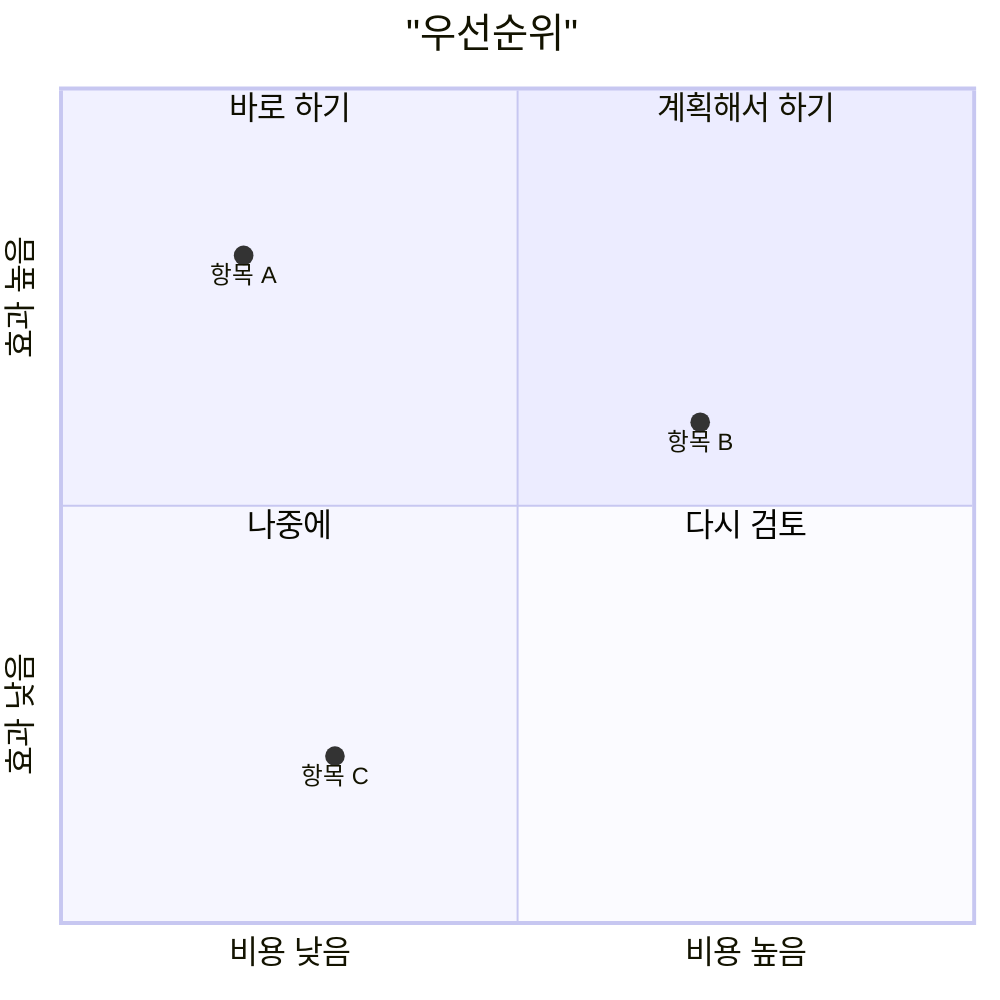

---

## 15. 연대표 — `timeline`
개발 일정 · 버전 · 로드맵.

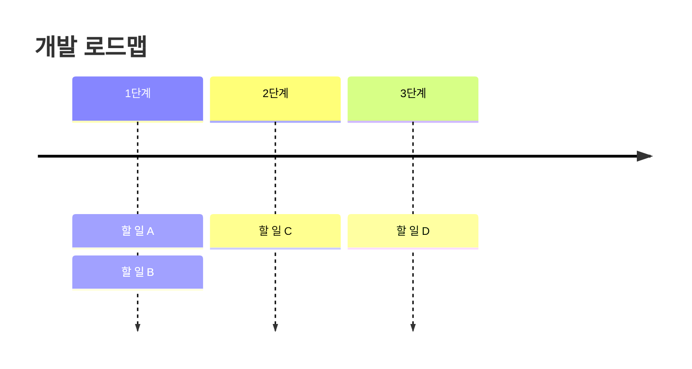

---

## 16. 깃 그래프 — `gitGraph`
git 브랜치 · 병합 흐름 (협업 설명용).

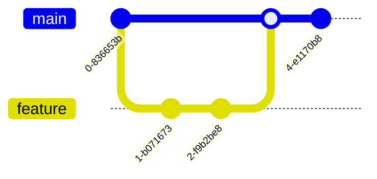

---

## 17. 레이더 차트 — `radar-beta`
무기 · 캐릭터 능력치를 **여러 항목으로 한 번에** 비교. 거미줄 모양에서 바깥으로 갈수록 값이 커요.

| 쓰는 법 | 뜻 |
|---|---|
| `axis id["이름"], …` | 비교할 항목 (꼭짓점) — 3 ~ 6개가 읽기 좋아요 |
| `curve id["이름"]{값, 값, …}` | 비교 대상 하나 (무기 · 캐릭터) — 값은 axis 순서대로 |
| `max 100` · `min 0` | 눈금 범위 |
| `graticule polygon` | 눈금을 원 대신 다각형으로 |

**[레이더 차트] 제목**
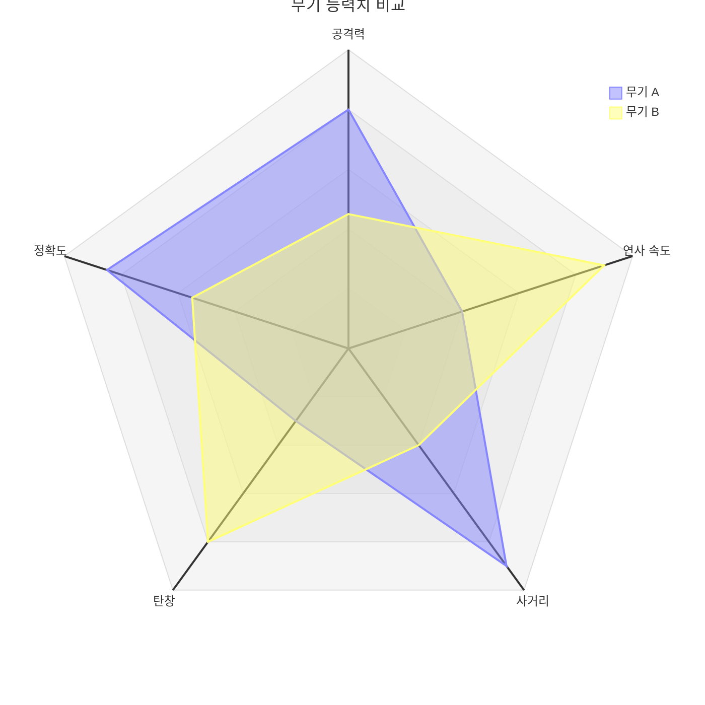
> 읽는 법: 꼭짓점 = 능력치 항목, 색 도형 = 무기(캐릭터) 하나예요. 도형이 넓을수록 전체적으로 강하고, 한쪽으로 튀어나오면 그 항목이 특기예요.

- 비교 대상은 **2 ~ 3개까지** (더 많으면 겹쳐서 안 보여요)
- 최신 Mermaid(11.6 이상)에서만 그려져요. GitHub에서는 보이지만, VS Code 미리보기 확장이 오래된 버전이면 글자로만 보일 수 있어요.
