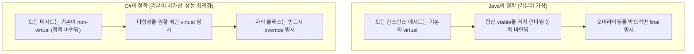
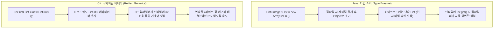
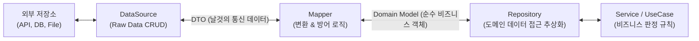

# Java vs C# 객체지향 프로그래밍(OOP) 핵심 원리와 언어 비교 바이블

> **본 문서는 Java 객체지향 프로그래밍 강의 커리큘럼을 기반으로, C#과의 1:1 비교 분석을 통해 두 언어의 런타임 메커니즘과 객체지향 설계의 본질을 꿰뚫는 복습 및 기술 면접 대비 가이드입니다.**

---

## 📑 전체 목차

1. [인스턴스와 클래스 & 객체 생성 메커니즘](#1-인스턴스와-클래스--객체-생성-메커니즘)
2. [정보 은닉과 캡슐화 (Encapsulation)](#2-정보-은닉과-캡슐화-encapsulation)
3. [상속(Inheritance)과 가상 메서드 테이블 (vtable)](#3-상속inheritance과-가상-메서드-테이블-vtable)
4. [다형성(Polymorphism)과 타입 캐스팅](#4-다형성polymorphism과-타입-캐스팅)
5. [추상 클래스(Abstract Class) vs 인터페이스(Interface)](#5-추상-클래스abstract-class-vs-인터페이스interface)
6. [제네릭(Generic)의 근본 원리: Type Erasure vs Reified Generics](#6-제네릭generic의-근본-원리-type-erasure-vs-reified-generics)
7. [컬렉션 프레임워크와 핵심 자료구조](#7-컬렉션-프레임워크와-핵심-자료구조)
8. [인스턴스 기본 조작 (Object Contract & Immutability)](#8-인스턴스-기본-조작-object-contract--immutability)
9. [문자열 조작과 메모리 최적화](#9-문자열-조작과-메모리-최적화)
10. [단위 테스트 기초 (JUnit 5 vs xUnit)](#10-단위-테스트-기초-junit-5-vs-xunit)

---

## 1. 인스턴스와 클래스 & 객체 생성 메커니즘

### 1.1 근본 원리: 클래스(Class)와 인스턴스(Instance)의 본질

* **가상 세계의 창조**: 객체지향 프로그래밍은 현실 세계의 개념과 상태를 컴퓨터 메모리에 모델링하는 작업입니다.
* **클래스(Class)**: 객체를 생성하기 위한 **틀(설계도, Blueprint)**입니다. 메서드 코드와 메타데이터는 프로세스의 메서드 영역(Method Area / Type Handle)에 단 한 번만 로드됩니다.
* **인스턴스(Instance / Object)**: `new` 연산자를 통해 힙(Heap) 메모리에 실제로 할당된 **실체**입니다. 각 인스턴스는 자신만의 필드 상태(데이터)를 독립적으로 유지합니다.
* **정적(Static) 멤버 vs 인스턴스(Instance) 멤버**:
  * 인스턴스 멤버: 객체가 생성될 때마다 힙에 개별적으로 할당됨.
  * 정적 멤버: 클래스가 메모리에 로드될 때 단 한 번 할당되며 모든 인스턴스가 공유함.

### 1.2 생성자 연쇄와 초기화 비교

생성자(Constructor)는 인스턴스가 힙에 생성될 때 필드를 유효한 초기 상태로 설정하는 특수 메서드입니다.

#### Java: 일반 생성자 및 `this()`, `super()`

```java
public class Hero {
    private String name;
    private int hp;

    // 기본 생성자
    public Hero() {
        this("이름없음", 100); // 다른 생성자 호출 (생성자 체이닝)
    }

    // 매개변수 생성자
    public Hero(String name, int hp) {
        this.name = name;
        this.hp = hp;
    }
}

public class SuperHero extends Hero {
    private boolean flying;

    public SuperHero(String name, int hp, boolean flying) {
        super(name, hp); // 부모 생성자 명시적 호출 (첫 줄 필수)
        this.flying = flying;
    }
}
```

#### C#: 생성자 이니셜라이저, 주 생성자(Primary Constructor) & 객체 이니셜라이저

C#은 더 간결하고 현대적인 생성자 문법을 제공합니다.

```csharp
// 1. 전통적인 생성자 체이닝 (: this(), : base())
public class Hero
{
    public string Name { get; set; }
    public int Hp { get; set; }

    public Hero() : this("이름없음", 100) { }

    public Hero(string name, int hp)
    {
        Name = name;
        Hp = hp;
    }
}

public class SuperHero : Hero
{
    public bool Flying { get; set; }

    public SuperHero(string name, int hp, bool flying) : base(name, hp)
    {
        Flying = flying;
    }
}

// 2. C# 12 주 생성자 (Primary Constructor)
public class ModernHero(string name, int hp)
{
    public string Name { get; } = name;
    public int Hp { get; set; } = hp;
}

// 3. 객체 이니셜라이저 (생성자 오버로딩 폭발을 막는 문법)
var hero = new Hero { Name = "배트맨", Hp = 200 };
```

---

## 2. 정보 은닉과 캡슐화 (Encapsulation)

### 2.1 근본 원리: 캡슐화의 본질은 "불변식(Invariant)의 수호"

초보 개발자는 캡슐화를 단순히 "변수를 `private`으로 숨기고 기계적으로 Getter/Setter를 만드는 것"으로 오해합니다.

* **캡슐화의 진짜 목적**:
  1. **데이터 보호**: 외부에서 허용되지 않은 값(예: 음수 나이, 비어 있는 이름)을 마구 주입해 객체의 상태를 오염시키는 것을 차단.
  2. **불변식(Invariant) 보장**: 객체가 생성되어 소멸할 때까지 스스로의 규칙을 엄격히 통제.
  3. **내부 구현의 은닉**: 내부 자료구조가 배열에서 해시맵으로 바뀌어도 외부 호출 코드에는 영향이 없도록 격리.

### 2.2 접근 제어자 비교

| 접근 제어자 | Java 범위 | C# 대응 키워드 | C# 범위 |
|---|---|---|---|
| `private` | 동일 클래스 내부만 | `private` | 동일 클래스/구조체 내부만 |
| *(default)* | 동일 패키지 내부 (Package-Private) | `internal` *(유사)* | 동일 어셈블리(.dll/.exe) 내부 |
| `protected` | 동일 패키지 + 다른 패키지의 상속 클래스 | `protected` | 상속 관계의 파생 클래스만 |
| *(없음)* | 없음 | `protected internal` | 동일 어셈블리 OR 파생 클래스 |
| *(없음)* | 없음 | `private protected` | 동일 어셈블리 AND 파생 클래스 |
| `public` | 모든 곳에서 접근 가능 | `public` | 모든 곳에서 접근 가능 |

### 2.3 프로퍼티(Property) 비교: 메서드 vs 언어 차원의 속성

#### Java: 관례적 메서드 & Lombok

Java는 문법적으로 속성(Property) 개념이 없어 `getXXX()`, `setXXX()` 메서드를 직접 정의하거나 Lombok `@Getter/@Setter`에 의존합니다.

```java
public class Person {
    private String name;
    private int age;

    public String getName() { return name; }

    public void setAge(int age) {
        if (age < 0) {
            throw new IllegalArgumentException("나이는 음수가 될 수 없습니다.");
        }
        this.age = age;
    }
}
```

#### C#: 언어 차원의 프로퍼티 & `init` 전용 접근자

C#은 속성을 일급 언어 기능으로 지원하며, C# 9.0부터 객체 생성 시점에만 초기화 가능한 `init` 접근자를 지원합니다.

```csharp
public class Person
{
    // 자동 구현 프로퍼티 (Backing Field 자동 생성)
    public string Name { get; init; } // 생성 이후 수정 불가 (불변성 보장)

    private int _age;
    public int Age
    {
        get => _age;
        set
        {
            if (value < 0)
                throw new ArgumentException("나이는 음수가 될 수 없습니다.");
            _age = value;
        }
    }
}

// 사용부
var p = new Person { Name = "홍길동", Age = 25 };
// p.Name = "이순신"; // 컴파일 에러! (init 전용)
```

---

## 3. 상속(Inheritance)과 가상 메서드 테이블 (vtable)

### 3.1 근본 원리: 상속의 본질과 "다이아몬드 문제"

* **상속(Inheritance)**: 기존 클래스의 필드와 메서드를 물려받아 새로운 클래스를 정의하는 기법(`is-a` 관계 성립 시에만 사용).
* **다중 상속(Multiple Inheritance) 금지 이유**: 두 부모 클래스에 동일한 이름의 메서드가 정의되어 있을 때 어느 부모의 것을 호출해야 할지 모호해지는 **다이아몬드 문제(Diamond Problem)**가 발생하므로, Java와 C# 모두 다중 클래스 상속을 금지하고 단일 상속만 허용합니다.

### 3.2 Java vs C# 가상 메서드 테이블(vtable)의 결정적 차이 (기술 면접 1순위)

이 부분은 Java와 C#의 런타임 철학이 가장 극명하게 갈리는 지점입니다.



#### (1) Java 코드: 암묵적 가상 메서드

```java
public class Parent {
    public void SayHello() {
        System.out.println("Parent");
    }
}

public class Child extends Parent {
    @Override // 단순 어노테이션 (생략해도 가상 오버라이딩 동작)
    public void SayHello() {
        System.out.println("Child");
    }
}

Parent p = new Child();
p.SayHello(); // 출력: "Child" (런타임 객체 타입에 따라 동적 호출)
```

#### (2) C# 코드: 명시적 `virtual`, `override` vs `new` (메서드 하이딩)

C#에서는 기본 메서드가 비가상이므로 상위 타입 변수로 호출하면 부모의 메서드가 직통으로 실행됩니다.

```csharp
public class Parent
{
    // virtual이 없으면 비가상 메서드
    public void NonVirtualMethod() => Console.WriteLine("Parent NonVirtual");
    public virtual void VirtualMethod() => Console.WriteLine("Parent Virtual");
}

public class Child : Parent
{
    // new: 부모의 비가상 메서드를 숨김 (Method Hiding)
    public new void NonVirtualMethod() => Console.WriteLine("Child Hiding");

    // override: 부모의 가상 메서드를 vtable에서 교체 (Overriding)
    public override void VirtualMethod() => Console.WriteLine("Child Override");
}

Parent p = new Child();
p.NonVirtualMethod(); // 출력: "Parent NonVirtual" (컴파일 타임 정적 바인딩!)
p.VirtualMethod();    // 출력: "Child Override"    (vtable 동적 바인딩!)
```

> **면접 포인트 요약**:
> Java는 기본이 동적 바인딩(가상 메서드)이므로 안전한 다형성을 우선시하지만 vtable 탐색 오버헤드가 있습니다.
> C#은 기본이 정적 바인딩이므로 함수 호출 성능(인라인 최적화)을 극대화하고, 다형성이 필요한 경우에만 명시적으로 `virtual`/`override`를 선언하도록 설계되었습니다.

---

## 4. 다형성(Polymorphism)과 타입 캐스팅

### 4.1 근본 원리: "하나의 메시지, 다양한 행동"

다형성은 **동일한 인터페이스(메서드 호출)에 대해 각 객체가 저마다의 고유한 방식으로 응답**할 수 있는 능력입니다.

* **업캐스팅 (Upcasting)**: 자식 인스턴스를 부모 타입 변수에 대입 $\rightarrow$ **100% 안전하며 암시적 변환 가능**.
* **다운캐스팅 (Downcasting)**: 부모 타입 변수를 원래의 구체 자식 타입으로 복원 $\rightarrow$ **위험하며 명시적 형변환 필요** (실제 객체가 맞지 않으면 런타임 에러).

### 4.2 안전한 타입 검사와 패턴 매칭 비교

#### Java: `instanceof`의 진화

```java
// Java 14 이전
if (monster instanceof Slime) {
    Slime s = (Slime) monster; // 번거롭고 위험한 명시적 캐스팅
    s.runAway();
}

// Java 16+ 패턴 매칭 instanceof
if (monster instanceof Slime s) {
    s.runAway(); // 타입 검사와 캐스팅 변수 바인딩을 동시에 수행
}
```

#### C#: `is`, `as` 연산자와 스위치 식 패턴 매칭

```csharp
// 1. as 연산자: 형변환 실패 시 예외를 던지지 않고 null 반환
Slime? s = monster as Slime;
if (s != null)
{
    s.RunAway();
}

// 2. is 패턴 매칭 (C# 7+)
if (monster is Slime slime)
{
    slime.RunAway();
}

// 3. 패턴 매칭 switch 식 (현대 C# 실무 표준)
string action = monster switch
{
    Slime s => $"슬라임 {s.Suffix}가 도망쳤습니다.",
    Goblin g => $"고블린이 몽둥이를 휘두릅니다. 공격력: {g.AttackPower}",
    _ => "알 수 없는 몬스터입니다."
};
```

---

## 5. 추상 클래스(Abstract Class) vs 인터페이스(Interface)

### 5.1 근본 원리: "무엇인가(is-a)" vs "무엇을 할 수 있는가(can-do)"

| 구분 | 추상 클래스 (Abstract Class) | 인터페이스 (Interface) |
|---|---|---|
| **존재 이유** | 하위 클래스들의 **공통 상태(필드)와 기본 로직을 공유** | 클래스가 외부 세계에 제공하는 **행동 규약(Contract)을 정의** |
| **관계** | 밀접한 상속 계층 (`is-a`) | 다형적 행동 장착 (`can-do` / `has-a`) |
| **다중 구현** | 불가능 (단일 상속만 지원) | **다중 구현(Multiple Implementation) 가능** |
| **필드(상태)** | 인스턴스 필드(변수)를 자유롭게 가질 수 있음 | 상태(인스턴스 필드)를 가질 수 없음 |

### 5.2 현대 언어의 확장과 C# 명시적 인터페이스 구현

최신 Java(Java 8+)와 C#(C# 8.0+) 모두 인터페이스에 **기본 구현 메서드(Default Method)**를 작성할 수 있게 진화했습니다.

#### C#만의 필살기: 명시적 인터페이스 구현 (Explicit Interface Implementation)

두 개의 서로 다른 인터페이스에 우연히 동일한 이름의 메서드가 있을 때 충돌을 우아하게 해결합니다.

```csharp
public interface IPlayer
{
    void Attack();
}

public interface IMonster
{
    void Attack();
}

// 두 인터페이스의 Attack을 완벽히 격리하여 따로 구현
public class HybridCharacter : IPlayer, IMonster
{
    void IPlayer.Attack()
    {
        Console.WriteLine("플레이어로서 무기를 휘두릅니다.");
    }

    void IMonster.Attack()
    {
        Console.WriteLine("몬스터로서 발톱으로 공격합니다.");
    }
}

// 호출 시 해당 인터페이스로 캐스팅하여 명시적으로 호출
HybridCharacter hc = new HybridCharacter();
// hc.Attack(); // 컴파일 에러! (직접 노출되지 않음)

((IPlayer)hc).Attack();  // "플레이어로서 무기를 휘두릅니다."
((IMonster)hc).Attack(); // "몬스터로서 발톱으로 공격합니다."
```

---

## 6. 제네릭(Generic)의 근본 원리: Type Erasure vs Reified Generics

### 6.1 컴파일러와 런타임의 거대한 차이

이 주제는 **Java 개발자와 C# 개발자를 구분하는 가장 깊은 런타임 아키텍처 질문**입니다.



### 6.2 비교 분석표

| 비교 항목 | Java (Type Erasure) | C# (Reified Generics) |
|---|---|---|
| **제네릭 소거 시점** | **컴파일 시점**에 타입 정보가 완전히 지워짐 | **런타임(CLR)까지 타입 메타데이터가 완벽 보존됨** |
| **원시 타입 지원** | 불가능 (`List<int>` 불가 $\rightarrow$ `List<Integer>` 필수) | **완벽 지원 (`List<int>`, `List<float>` 등)** |
| **박싱(Boxing) 오버헤드** | 원시 타입을 래퍼 객체로 포장하므로 **심각한 힙 할당 발생** | **박싱이 전혀 발생하지 않음 (순수 값 타입 배열)** |
| **런타임 타입 검사** | `list instanceof List<String>` 검사 불가능 | `if (list is List<string>)` 완벽 가능 |
| **새 인스턴스 생성** | `new T()` 직접 생성 불가능 | `where T : new()` 제약으로 `new T()` 가능 |

---

## 7. 컬렉션 프레임워크와 핵심 자료구조

### 7.1 자료구조의 빅오(Big-O)와 선택 기준

1. **배열 / List (`ArrayList` / `List<T>`)**:
   * 메모리에 연속적으로 배치되는 동적 배열.
   * 인덱스 접근(`list[i]`): $O(1)$ $\rightarrow$ 조회가 빈번할 때 최상.
   * 중간 삽입/삭제: $O(N)$ (뒤의 요소들을 밀거나 당겨야 함).
2. **Set (`HashSet` / `HashSet<T>`)**:
   * 중복을 허용하지 않는 고유 집합.
   * 해시 함수를 통해 인덱스를 산출하여 탐색/추가/삭제 $O(1)$.
3. **Map / Dictionary (`HashMap` / `Dictionary<TKey, TValue>`)**:
   * 키(Key)-값(Value) 쌍 저장소.
   * Key의 해시코드를 기반으로 버킷에 접근하므로 조회 $O(1)$.

### 7.2 Java vs C# 컬렉션 1:1 대조표

| 개념 | Java Collection Framework | .NET (C#) Generic Collections |
|---|---|---|
| 동적 배열 | `java.util.ArrayList<E>` | `System.Collections.Generic.List<T>` |
| 연결 리스트 | `java.util.LinkedList<E>` | `System.Collections.Generic.LinkedList<T>` |
| 해시 기반 집합 | `java.util.HashSet<E>` | `System.Collections.Generic.HashSet<T>` |
| 정렬된 집합 | `java.util.TreeSet<E>` (Red-Black Tree) | `System.Collections.Generic.SortedSet<T>` |
| 해시 테이블 | `java.util.HashMap<K, V>` | `System.Collections.Generic.Dictionary<TKey, TValue>` |
| 순회 인터페이스 | `Iterable<T>`, `Iterator<T>` | `IEnumerable<T>`, `IEnumerator<T>` |

---

## 8. 인스턴스 기본 조작 (Object Contract & Immutability)

### 8.1 최상위 클래스의 규약 (Object Contract)

모든 객체의 조상인 `Object` 클래스(Java: `java.lang.Object`, C#: `System.Object`)는 인스턴스의 기본 동작을 정의합니다.

#### (1) `equals` / `Equals`와 `hashCode` / `GetHashCode`의 철칙

> **황금률**: 두 객체가 `equals`에 의해 같다고 판정되면, 두 객체의 `hashCode`는 **반드시 동일한 정수값**을 반환해야 한다!

* 이유: `HashSet`이나 `HashMap`/`Dictionary`는 데이터를 찾을 때 먼저 `hashCode`를 계산해 버킷을 찾은 뒤, 버킷 안에서 `equals`를 비교합니다. `hashCode`를 재정의하지 않으면 내용이 같아도 서로 다른 버킷으로 분류되어 조회가 실패합니다.

#### Java 구현 예시

```java
public class Account {
    private String accountNumber;
    private int balance;

    @Override
    public boolean equals(Object o) {
        if (this == o) return true;
        if (o == null || getClass() != o.getClass()) return false;
        Account account = (Account) o;
        return Objects.equals(accountNumber, account.accountNumber);
    }

    @Override
    public int hashCode() {
        return Objects.hash(accountNumber);
    }
}
```

#### C# 구현 예시 및 `record`

C#에서는 메서드 오버라이드뿐만 아니라 `==` 연산자 오버로딩까지 관례적으로 작성합니다. 그러나 최신 C#에서는 **`record`**를 사용하면 이 모든 코드가 한 줄로 자동 완성됩니다.

```csharp
// 수동 구현 방식
public class Account : IEquatable<Account>
{
    public string AccountNumber { get; set; }

    public override bool Equals(object? obj) => Equals(obj as Account);
    public bool Equals(Account? other) => other != null && AccountNumber == other.AccountNumber;
    public override int GetHashCode() => HashCode.Combine(AccountNumber);
    public static bool operator ==(Account? left, Account? right) => Equals(left, right);
    public static bool operator !=(Account? left, Account? right) => !Equals(left, right);
}

// 현대적 C# 해결책: record (값 기반 동등성, HashCode, ToString 자동 생성)
public record ModernAccount(string AccountNumber, int Balance);
```

### 8.2 정렬 규약: `Comparable` vs `Comparator`

* **`Comparable` (`IComparable<T>`)**: 객체 스스로가 가지는 **자연스러운 순서(Natural Ordering)** 정의 (`compareTo` / `CompareTo`).
* **`Comparator` (`IComparer<T>`)**: 기본 정렬 외에 **외부에서 주입하는 특별한 정렬 기준** (예: 나이순, 이름 역순).

---

## 9. 문자열 조작과 메모리 최적화

### 9.1 `String`의 불변성(Immutability)과 문자열 상수 풀

Java와 C#의 문자열은 모두 **불변(Immutable)**입니다.

```csharp
string s = "Hello";
s += " World"; // "Hello"가 수정되는 것이 아니라, 힙에 "Hello World"라는 새로운 인스턴스가 생성됨!
```

* **문자열 상수 풀 (String Intern Pool)**:
  * 리터럴로 선언된 문자열은 힙 내부의 인터닝 풀(Intern Pool)에 단 하나만 캐싱되어 메모리를 절약합니다.
* **대량 결합 시 `StringBuilder`의 필수성**:
  * 루프 안에서 `+` 연산자로 문자열을 계속 붙이면 수천 개의 쓰레기 객체가 힙에 생성되어 GC가 폭주합니다.
  * `StringBuilder`는 내부 가변 버퍼(char[])를 늘려가며 작업하므로 메모리 낭비 없이 $O(N)$으로 결합합니다.

### 9.2 문자열 서식화 비교

```java
// Java: String.format 또는 번거로운 결합
String msg = String.format("용사 %s의 남은 체력은 %d입니다.", hero.getName(), hero.getHp());
```

```csharp
// C#: 가독성과 컴파일 타임 검증이 뛰어난 문자열 보간 (String Interpolation)
string msg = $"용사 {hero.Name}의 남은 체력은 {hero.Hp}입니다.";
```

---

## 10. 단위 테스트 기초 (JUnit 5 vs xUnit)

### 10.1 테스트 프레임워크 1:1 비교

| 항목 | Java (JUnit 5) | C# (.NET xUnit) |
|---|---|---|
| **테스트 메서드 어트리뷰트** | `@Test` | `[Fact]` / `[Theory]`(파라미터 테스트) |
| **사전 준비 (Setup)** | `@BeforeEach void setUp()` | **클래스 생성자**에서 실행 |
| **사후 정리 (Teardown)** | `@AfterEach void tearDown()` | **`IDisposable.Dispose()`**에서 실행 |
| **단언문 클래스** | `org.junit.jupiter.api.Assertions` | `Xunit.Assert` |
| **동등성 검증** | `assertEquals(expected, actual)` | `Assert.Equal(expected, actual)` |
| **예외 발생 검증** | `assertThrows(Exception.class, () -> ...)` | `Assert.Throws<Exception>(() => ...)` |

---

# C# 아키텍처 바이블: 근본 원리부터 클린 아키텍처 & 기술 면접 완벽 대비

> **본 가이드는 C#을 활용한 현대적 애플리케이션 아키텍처의 핵심 원리와 실무 패턴을 단계별로 정리한 복습 및 기술 면접 대비 마크다운 문서입니다.**
> 단순한 문법 습득을 넘어 **"왜 이러한 패턴과 구조가 탄생했는가?"**에 대한 근본적인 철학과 트레이드오프를 체득할 수 있도록 구성되었습니다.
> 자매 가이드: [Java vs C# 객체지향 프로그래밍(OOP) 핵심 원리와 언어 비교 바이블](java_vs_csharp_oop_core_guide.md)

---

## 📑 전체 목차

1. [현대적 C#과 함수형 패러다임 (Functional Programming & LINQ)](#1-현대적-c과-함수형-패러다임-functional-programming--linq)
2. [견고한 예외 처리와 리소스 수명 주기 관리 (Exception & I/O Resource)](#2-견고한-예외-처리와-리소스-수명-주기-관리-exception--io-resource)
3. [데이터 포맷과 네트워크 통신 (Serialization & HTTP)](#3-데이터-포맷과-네트워크-통신-serialization--http)
4. [고성능 비동기 프로그래밍 (Asynchronous Programming)](#4-고성능-비동기-프로그래밍-asynchronous-programming)
5. [데이터 계층 분리와 추상화 (DataSource, DTO, Mapper, Model, Repository)](#5-데이터-계층-분리와-추상화-datasource-dto-mapper-model-repository)
6. [품질 검증과 실패 모델링 (Unit Test & Result Pattern)](#6-품질-검증과-실패-모델링-unit-test--result-pattern)
7. [객체지향 설계 원칙과 클린 아키텍처 (OOP Principles, Design Patterns & Clean Architecture)](#7-객체지향-설계-원칙과-클린-아키텍처-oop-principles-design-patterns--clean-architecture)

---

## 1. 현대적 C#과 함수형 패러다임 (Functional Programming & LINQ)

### 1.1 근본 원리: 왜 함수형 패러다임을 도입했는가?

C#은 순수한 객체지향 프로그래밍(OOP) 언어로 출발했으나, 멀티코어 프로세서의 보급과 상태(State) 변이로 인한 동시성 버그를 줄이기 위해 **함수형 프로그래밍(FP)**의 장점을 적극 흡수한 멀티 패러다임 언어로 진화했습니다.

* **1급 객체 (First-Class Citizen)**:
  * 변수에 대입할 수 있는 객체를 1급 객체라 합니다.
  * 대표적인 1급 객체: 기본 값(Value), 인스턴스(Object Reference), **함수(Function)**.
  * 함수가 1급 객체로 취급된다는 것은 함수를 **변수에 저장**, **인자로 전달**, **반환값으로 반환**할 수 있음을 의미합니다.
* **수학적 순수 함수 (Pure Function)**:
  * 동일한 입력(x)에 대해 항상 동일한 출력(f(x) = 2x + 3)을 보장합니다.
  * 외부 상태를 변경하지 않는 **부수 효과(Side Effect)의 제거**가 핵심입니다.
* **메서드 vs 함수**:
  * **메서드(Method)**: 특정 클래스/구조체에 종속되며, 인스턴스의 내부 상태를 조작하기 위한 소속된 서브루틴입니다.
  * **함수(Function)**: 입출력의 매핑 그 자체이며, 소속된 이름보다 전달되는 행위(시그니처)가 핵심입니다.

### 1.2 핵심 문법 및 구현

#### (1) 대리자(Delegate)와 내장 대리자 (`Func`, `Action`, `Predicate`)

C#에서 델리게이트는 **"타입 안전한 함수 포인터(Type-safe Function Pointer)"**입니다.

```csharp
// 1. 커스텀 델리게이트 선언
public delegate int Calculate(int a, int b);

// 2. C# 내장 제네릭 델리게이트 활용 (실무 표준)
// Action: 반환값이 없는(void) 함수
Action<string> printLog = message => Console.WriteLine($"[LOG] {message}");

// Func: 마지막 타입 인자가 반환값인 함수
Func<int, int, int> add = (a, b) => a + b;

// Predicate: 조건을 검사하여 bool을 반환하는 함수 (Func<T, bool>과 호환)
Predicate<int> isEven = x => x % 2 == 0;
```

#### (2) 람다식(Lambda Expression)과 익명 함수

* 별도의 메서드 정의 없이, 실행 위치에서 즉시 인라인으로 생성하는 이름 없는 함수입니다.
* 문법: `(매개변수) => 식 또는 블록`

```csharp
// 식 본문 람다 (Expression Lambda)
Func<int, int> square = x => x * x;

// 문 본문 람다 (Statement Lambda)
Func<int, int, int> safeDiv = (a, b) =>
{
    if (b == 0) throw new DivideByZeroException();
    return a / b;
};
```

#### (3) 고계 함수(Higher-Order Function)와 LINQ

고계 함수란 **다른 함수를 매개변수로 받거나 함수를 반환하는 함수**입니다. C#의 LINQ(Language Integrated Query)는 고계 함수의 정수입니다.

| LINQ 연산자 | 함수형 표준 개념 | 설명 |
|---|---|---|
| `Where` | Filter | 조건을 만족하는 요소만 추출 |
| `Select` | Map / Transform | 요소를 새로운 형태로 투영 및 변환 |
| `Aggregate` | Reduce / Fold | 누적 함수를 적용해 컬렉션을 단일 값으로 축소 |
| `Any` / `All` | Quantifier | 조건을 만족하는 요소의 존재 여부 판단 |
| `ForEach` | Side Effect | 각 요소에 대해 지정된 액션 실행 |
| `ToList` / `ToHashSet` | Materialize | 지연 평가된 시퀀스를 실제 메모리 컬렉션으로 실체화 및 중복 제거 |

```csharp
var numbers = new List<int> { 1, 2, 3, 4, 5, 6 };

// Where & Select를 활용한 선언형 데이터 파이프라인
var evenSquares = numbers
    .Where(n => n % 2 == 0) // 짝수 필터링 (고계 함수: Predicate 전달)
    .Select(n => n * n)     // 제곱 변환 (고계 함수: Transformer 전달)
    .ToList();              // 즉시 평가 (Materialization)

// Aggregate (누적 축소): 합계 계산
int totalSum = numbers.Aggregate(0, (acc, next) => acc + next);
```

#### (4) 실전 연습: 트랜잭션 도메인 쿼리 풀이

슬라이드에 수록된 고전 LINQ 쿼리 종합 예제입니다.

```csharp
public class Trader
{
    public string Name { get; set; }
    public string City { get; set; }
    public Trader(string name, string city) { Name = name; City = city; }
}

public class Transaction
{
    public Trader Trader { get; set; }
    public int Year { get; set; }
    public int Value { get; set; }
    public Transaction(Trader trader, int year, int value)
    {
        Trader = trader; Year = year; Value = value;
    }
}

// 실전 질의 모음
var transactions = new List<Transaction>
{
    new Transaction(new Trader("Brian", "Cambridge"), 2011, 300),
    new Transaction(new Trader("Raoul", "Cambridge"), 2012, 1000),
    new Transaction(new Trader("Raoul", "Cambridge"), 2011, 400),
    new Transaction(new Trader("Mario", "Milan"), 2012, 710),
    new Transaction(new Trader("Mario", "Milan"), 2012, 700),
    new Transaction(new Trader("Alan", "Cambridge"), 2012, 950)
};

// 1. 2011년에 발생한 모든 트랜잭션을 가격 오름차순으로 정렬하여 거래자 이름 추출
var q1 = transactions
    .Where(t => t.Year == 2011)
    .OrderBy(t => t.Value)
    .Select(t => t.Trader.Name);

// 2. 거래자가 근무하는 모든 도시를 중복 없이 나열
var q2 = transactions.Select(t => t.Trader.City).Distinct();

// 3. 케임브리지에서 근무하는 모든 거래자를 찾아 이름순으로 정렬
var q3 = transactions
    .Select(t => t.Trader)
    .Where(trader => trader.City == "Cambridge")
    .DistinctBy(trader => trader.Name)
    .OrderBy(trader => trader.Name);

// 4. 밀라노에 거래자가 있는가?
bool q4 = transactions.Any(t => t.Trader.City == "Milan");

// 5. 전체 트랜잭션 중 최댓값과 최솟값
int maxValue = transactions.Max(t => t.Value);
int minValue = transactions.Min(t => t.Value);
```

---

## 2. 견고한 예외 처리와 리소스 수명 주기 관리 (Exception & I/O Resource)

### 2.1 근본 원리: 예외(Exception)와 에러의 본질

소프트웨어 실행 중 발생할 수 있는 이상 상태를 3가지로 분류하고 그에 맞게 대처해야 합니다.

1. **문법 에러 (Syntax Error)**: 컴파일러가 잡아내는 형식적 코드 오류 $\rightarrow$ 빌드 시점 100% 제거 가능.
2. **런타임 에러 (Runtime Error)**: 실행 중 파일 누락, 네트워크 단절, 메모리 고갈 등 예상치 못한 외부 환경 요인으로 발생 $\rightarrow$ **예외 처리(Exception Handling)**의 대상.
3. **논리 에러 (Logic Error)**: 문법도 맞고 실행도 되지만, 요구사항과 다른 계산 결과를 내는 버그 $\rightarrow$ **단위 테스트(Unit Test)**로 사전 방지.

### 2.2 리소스 관리와 `IDisposable`

운영체제의 파일 핸들, 소켓, DB 커넥션 등은 .NET 가비지 컬렉터(GC)가 제어하지 못하는 **비관리 리소스(Unmanaged Resources)**입니다.

* 리소스를 열었으면(`Open`), 작업 후 반드시 즉시 닫아야(`Close`) 누수(Leak)를 막을 수 있습니다.
* C#은 이를 보장하기 위해 `IDisposable` 인터페이스와 `using` 문을 제공합니다.

```csharp
// C# 8.0 이전: 중첩 try-finally 블록
FileStream fs = null;
try
{
    fs = new FileStream("log.txt", FileMode.Open);
    // 작업 수행
}
finally
{
    if (fs != null) fs.Dispose();
}

// C# 8.0 이상: using 선언 (스코프 종료 시 자동 Dispose 보장)
public void CopyFileSafely(string sourcePath, string destPath)
{
    using var reader = new StreamReader(sourcePath);
    using var writer = new StreamWriter(destPath);
    
    string line;
    while ((line = reader.ReadLine()) != null)
    {
        writer.WriteLine(line);
    }
}
```

### 2.3 실무 원칙: 예외 처리 Anti-Pattern 경계

* **Catch-All 무시(Swallowing) 금지**: `catch (Exception) { /* 빈 블록 */ }`은 디버깅을 불가능하게 만드는 최악의 패턴입니다.
* **흐름 제어용 예외 금지**: `try-catch` 블록 진입과 스택 트레이스 생성은 엄청난 CPU 오버헤드를 유발합니다. 일반적인 비즈니스 분기(예: 입력값 누락, 비밀번호 불일치)에는 예외 대신 **Result 패턴**을 적용해야 합니다.
* **Rethrow 시 스택 보존**: `catch (Exception ex) { throw ex; }`는 원래 스택 트레이스를 날려버립니다. 반드시 `throw;`를 사용해야 합니다.

---

## 3. 데이터 포맷과 네트워크 통신 (Serialization & HTTP)

### 3.1 근본 원리: 데이터 교환 형식의 진화

```
[CSV] (경량, 2차원 표 구조, 중첩/계층 표현 불가능)
   ↓
[XML] (태그 기반 정밀한 스키마, 가독성 높으나 오버헤드와 장황함 극심)
   ↓
[JSON] (Key-Value 기반, 경량, 계층 구조 지원, 전 세계 웹/앱 통신의 사실상 표준)
```

* **직렬화 (Serialization)**: 메모리 상의 C# 객체(인스턴스) $\rightarrow$ 네트워크 전송 및 파일 저장이 가능한 바이트/문자열 스트림.
* **역직렬화 (Deserialization)**: 문자열/바이트 스트림 $\rightarrow$ 타입 안전한 C# 인스턴스로 복원.

### 3.2 HTTP 기초와 RESTful API

* **URI / URL**: 자원의 고유 식별자.
* **HTTP 메서드와 멱등성(Idempotency)**:
  * `GET`: 자원 조회 (안전하며 멱등함, Body 지양).
  * `POST`: 신규 자원 생성 (비멱등, 호출할 때마다 새로운 데이터 생성).
  * `PUT`: 자원 전체 덮어쓰기 (멱등함).
  * `PATCH`: 자원 부분 수정 (상황에 따라 멱등/비멱등).
  * `DELETE`: 자원 삭제 (멱등함).

### 3.3 C# `HttpClient`의 근본적 함정과 해결책

많은 주니어 개발자가 `using (var client = new HttpClient())` 형태로 매 요청마다 인스턴스를 생성하고 폐기합니다.

* **문제 (소켓 고갈, Socket Exhaustion)**: `HttpClient`가 폐기되어도 내부 OS 소켓은 즉시 닫히지 않고 `TIME_WAIT` 상태로 대기합니다. 요청이 몰리면 열 수 있는 소켓 포트가 고갈되어 애플리케이션 전체가 먹통이 됩니다.
* **해결책**:
  * 단일 인스턴스를 `static` 또는 싱글톤으로 재사용.
  * 최신 .NET 권장: `IHttpClientFactory`를 DI로 주입받아 핸들러 수명 주기를 풀링(Pooling) 관리.

```csharp
public class NetworkService
{
    private readonly HttpClient _httpClient;

    // 의존성 주입을 통한 HttpClient 수명 주기 관리
    public NetworkService(HttpClient httpClient)
    {
        _httpClient = httpClient;
    }

    public async Task<string> DownloadJsonAsync(string url)
    {
        using var response = await _httpClient.GetAsync(url);
        response.EnsureSuccessStatusCode(); // 2xx 상태 코드가 아니면 예외 발생
        return await response.Content.ReadAsStringAsync();
    }
}
```

---

## 4. 고성능 비동기 프로그래밍 (Asynchronous Programming)

### 4.1 근본 원리: 동기 vs 비동기, CPU-Bound vs I/O-Bound

```
[ 동기 (Synchronous) ]
스레드: [----작업 A (28초 대기: 파일/네트워크)----] -> [작업 B 실행] (메인 스레드 멈춤/UI 프리징)

[ 비동기 (Asynchronous) ]
스레드: [작업 A 요청] -> [작업 B 즉시 실행 (UI 반응 유지)] -> [A 완료 시 통지 및 후속 처리]
```

* **동기(Sync)**: 앞선 작업이 끝날 때까지 스레드가 블로킹되어 아무 일도 못함 (1차선 도로의 병목).
* **비동기(Async)**: 지연 작업(I/O, 네트워크 대기)을 운영체제 커널 비동기 I/O 완성 포트(IOCP)에 위임하고, 스레드는 즉각 반환되어 다른 작업을 수행.
* **핵심 목표**: **"메인 스레드(UI/요청 처리)를 절대 차단하지 않는다."**

### 4.2 TAP (Task-based Asynchronous Pattern)과 `async` / `await`

* `async` 키워드는 컴파일러에게 해당 메서드가 **상태 머신(State Machine)**으로 분할되어야 함을 알립니다.
* `await`를 만나면:
  1. 현재 작업을 스케줄러에 등록하고 메서드를 즉시 탈출(Yield).
  2. 호출자(UI 스레드 등)는 자유로워져 다른 이벤트 루프를 처리.
  3. 비동기 작업이 완료되면, 나머지 코드가 캡처된 동기화 컨텍스트(SynchronizationContext) 또는 스레드 풀에서 이어서 실행(Resume).

### 4.3 실전 비동기 주의사항 (기술 면접 빈출)

| 구분 | 위험성 및 이유 | 올바른 접근법 |
|---|---|---|
| `async void` 금지 | 예외 발생 시 호출 스택으로 전파되지 않고 프로세스가 강제 크래시됨 | 이벤트 핸들러를 제외하고는 항상 `async Task`를 사용 |
| `.Result` / `.Wait()` 동기 블로킹 금지 | UI 컨텍스트가 대기 중인데 후속 작업이 같은 컨텍스트를 기다려 상호 교착(Deadlock) 발생 | 최상단까지 일관되게 `await`로 전파 (Async all the way) |
| 순수 I/O에 `Task.Run` 남용 금지 | 파일/네트워크 I/O는 스레드가 필요 없는데 불필요한 스레드 풀 스레드를 낭비함 | 순수 비동기 I/O API(`ReadAsync`, `GetAsync`) 직접 활용 |

---

## 5. 데이터 계층 분리와 추상화 (DataSource, DTO, Mapper, Model, Repository)

### 5.1 왜 계층을 분리하는가? (스파게티 코드 탈출)

초기 프로젝트는 UI나 비즈니스 로직 안에서 직접 SQL을 날리거나 JSON을 파싱합니다.

* **유지보수 지옥**: API 스키마 변경 시 화면 코드 수십 군데가 깨짐.
* **테스트 불가능**: 실제 네트워크와 DB가 켜져 있어야만 코드를 검증할 수 있음.
* **책임 혼재**: 한 클래스가 통신, 파싱, 비즈니스 계산, 화면 렌더링을 모두 수행함.

이를 해결하기 위해 **5단계 데이터 아키텍처**를 수립합니다.



### 5.2 각 계층의 정의와 구체적 역할

#### (1) DataSource 계층

* **책임**: 외부 데이터 저장소(Remote API, SQLite, PlayerPrefs, File)와 **직접 통신하는 최하단 계층**.
* **규칙**:
  * 비즈니스 로직을 전혀 알지 못함.
  * 서버에서 내려온 원시 문자열, 바이트, 또는 날것의 **DTO(Data Transfer Object)**를 그대로 반환.
  * `IRemoteDataSource`, `ILocalDataSource`로 인터페이스 분리.

#### (2) DTO (Data Transfer Object)

* **책임**: 네트워크 통신 규격이나 DB 스키마 형태를 1:1로 반영하는 **직렬화/역직렬화 전용 껍데기 객체**.
* **분리 이유**:
  * 서버의 JSON 필드명이 변경되거나 `snake_case`인 경우.
  * 특정 필드가 `null`로 내려오거나 동적 타입(동적 JSON)인 경우.
  * 불필요한 메타데이터 필드가 다수 포함된 경우.
  * **도메인 모델의 순수성을 지키기 위한 방화벽 역할**.

#### (3) Mapper (매퍼)

* **책임**: DTO를 신뢰할 수 있는 Domain Model로 변환하거나, 반대로 Model을 전송용 DTO로 변환.
* **핵심 구현**: C# **확장 메서드(Extension Methods)**를 활용한 가독성 높은 매핑.
* **방어적 변환**: `null` 필드 기본값 치환, 날짜 포맷 파싱 검증, 안전한 형변환 수행.

#### (4) Model (Domain Model)

* **책임**: 우리 애플리케이션의 **핵심 비즈니스 개념을 표현하는 순수한 객체**.
* **특징**:
  * 외부 라이브러리(Json.NET, DB ORM 속성 등)에 의존하지 않음.
  * **불변 객체(Immutable Object)**로 작성하는 것이 이상적 $\rightarrow$ C# `record` 권장.
  * 동등성 비교(`Equals`, `GetHashCode`), `ToString`이 값 기반으로 자동 구현됨.

#### (5) Repository 계층

* **책임**: 비즈니스 계층에게 필요한 **도메인 데이터 접근의 진입점을 제공하고, 데이터 소스를 캡슐화**.
* **특징**:
  * 로컬 캐시(메모리/DB)와 원격 서버(Remote DataSource)를 조율.
  * 화면이나 서비스는 데이터가 서버에서 오는지 로컬 파일에서 오는지 알 필요가 없음.
  * 항상 **인터페이스(`IRepository`)**를 통해 노출하여 단위 테스트 시 손쉬운 Mocking 지원.

### 5.3 완벽한 C# 코드 예제: 포켓몬 데이터 파이프라인

```csharp
// ==========================================
// 1. DTO (서버 JSON 규격 그대로 반영)
// ==========================================
public class PokemonDto
{
    [JsonPropertyName("id")]
    public int Id { get; set; }

    [JsonPropertyName("name")]
    public string? RawName { get; set; }

    [JsonPropertyName("base_experience")]
    public int? BaseExperience { get; set; }
}

// ==========================================
// 2. Domain Model (불변 record)
// ==========================================
public record Pokemon(int Id, string Name, int Exp);

// ==========================================
// 3. Mapper (확장 메서드로 DTO -> Model 변환)
// ==========================================
public static class PokemonMapper
{
    public static Pokemon ToModel(this PokemonDto dto)
    {
        return new Pokemon(
            Id: dto.Id,
            Name: dto.RawName ?? "Unknown Pokemon", // 방어 로직: Null Safe
            Exp: dto.BaseExperience ?? 0
        );
    }
}

// ==========================================
// 4. DataSource Interface & Implementation
// ==========================================
public interface IPokemonDataSource
{
    Task<PokemonDto> FetchPokemonByIdAsync(int id);
}

public class PokemonRemoteDataSource : IPokemonDataSource
{
    private readonly HttpClient _client;
    public PokemonRemoteDataSource(HttpClient client) => _client = client;

    public async Task<PokemonDto> FetchPokemonByIdAsync(int id)
    {
        var response = await _client.GetFromJsonAsync<PokemonDto>($"https://pokeapi.co/api/v2/pokemon/{id}");
        return response ?? throw new InvalidOperationException("응답이 비어있습니다.");
    }
}

// ==========================================
// 5. Repository Interface & Implementation
// ==========================================
public interface IPokemonRepository
{
    Task<Pokemon> GetPokemonAsync(int id);
}

public class PokemonRepositoryImpl : IPokemonRepository
{
    private readonly IPokemonDataSource _remoteDataSource;
    private readonly Dictionary<int, Pokemon> _memoryCache = new();

    public PokemonRepositoryImpl(IPokemonDataSource remoteDataSource)
    {
        _remoteDataSource = remoteDataSource;
    }

    public async Task<Pokemon> GetPokemonAsync(int id)
    {
        // 1. 캐시 확인
        if (_memoryCache.TryGetValue(id, out var cached))
            return cached;

        // 2. DataSource로부터 DTO 수신
        var dto = await _remoteDataSource.FetchPokemonByIdAsync(id);

        // 3. Mapper를 거쳐 도메인 모델로 변환
        var pokemon = dto.ToModel();

        // 4. 캐시 저장 후 도메인 반환
        _memoryCache[id] = pokemon;
        return pokemon;
    }
}
```

---

## 6. 품질 검증과 실패 모델링 (Unit Test & Result Pattern)

### 6.1 단위 테스트 이론과 F.I.R.S.T 원칙

단위 테스트는 애플리케이션의 가장 작은 단위(함수/클래스)가 설계대로 동작하는지 검증하는 안전망입니다.

* **회귀 방지**: 리팩터링 및 신규 기능 추가 시 기존 기능의 파손 여부를 1초 만에 감지.
* **F.I.R.S.T 원칙**:
  * **Fast (빠름)**: 테스트는 수 밀리초 단위로 수천 개가 실행되어야 함.
  * **Independent (독립적)**: 테스트 간 실행 순서나 공유 상태에 의존하지 않아야 함.
  * **Repeatable (반복 가능)**: 개발 환경, CI 서버, 오프라인 등 어떤 환경에서도 동일한 결과.
  * **Self-Validating (자체 검증)**: 결과가 성공/실패(Pass/Fail) bool 형태로 명확해야 함.
  * **Timely (적시성)**: 제품 코드가 배포되기 직전이나 작성 직전에 작성 (TDD 사이클).

### 6.2 AAA (Arrange - Act - Assert) 패턴

모든 단위 테스트는 명확한 3단계로 구조화합니다.

```csharp
[Fact]
public async Task GetPokemon_WhenValidId_ReturnsMappedDomainModel()
{
    // 1. Arrange (준비): 테스트 대역(Mock/Stub) 준비 및 의존성 주입
    var mockDataSource = new Mock<IPokemonDataSource>();
    mockDataSource.Setup(ds => ds.FetchPokemonByIdAsync(25))
                  .ReturnsAsync(new PokemonDto { Id = 25, RawName = "pikachu", BaseExperience = 112 });

    var repository = new PokemonRepositoryImpl(mockDataSource.Object);

    // 2. Act (실행): 테스트 대상 메서드 호출
    var result = await repository.GetPokemonAsync(25);

    // 3. Assert (검증): 결과가 기대치와 일치하는지 단언
    Assert.Equal(25, result.Id);
    Assert.Equal("pikachu", result.Name);
    Assert.Equal(112, result.Exp);
}
```

### 6.3 전통적 `try-catch`의 한계와 Result 패턴

#### 왜 Result 패턴인가?

1. **암묵적 에러 흐름의 위험성**: C#은 Java와 달리 `throws` 절(Checked Exception)이 없습니다. 메서드 시그니처만 보고는 어떤 예외가 터질지 알 수 없어 호출자가 모든 잠재적 예외를 추적하기 어렵습니다.
2. **에러는 예외가 아니다**: "ID에 해당하는 사용자가 없음", "네트워크 불안정으로 타임아웃", "잔액 부족" 등은 시스템의 치명적 결함(Crash)이 아니라 **비즈니스 도메인 상에서 일상적으로 발생하는 예측 가능한 실패**입니다.
3. **타입 기반의 컴파일 타임 검증**: 성공 결과(`T`)와 실패 결과(`E`)를 하나의 유니온 타입으로 반환하여, 호출자가 실패 처리를 누락하지 못하도록 컴파일 단계에서 강제합니다.

#### 현대적 C# Result 패턴 구현 (`sealed class` & `record`)

```csharp
// 도메인 에러 열거형 정의
public enum NetworkError
{
    NotFound,
    Timeout,
    Unknown
}

// 공용 Result 추상 타입
public abstract record Result<T, E>
{
    private Result() { } // 외부 상속 방지

    public sealed record Success(T Data) : Result<T, E>;
    public sealed record Failure(E Error) : Result<T, E>;
}

// Repository 또는 Service에서의 활용
public class SafePokemonRepository
{
    public async Task<Result<Pokemon, NetworkError>> GetPokemonSafelyAsync(int id)
    {
        try
        {
            // 네트워크 조회 시뮬레이션
            if (id <= 0) 
                return new Result<Pokemon, NetworkError>.Failure(NetworkError.NotFound);

            var pokemon = new Pokemon(id, "Pikachu", 100);
            return new Result<Pokemon, NetworkError>.Success(pokemon);
        }
        catch (TimeoutException)
        {
            return new Result<Pokemon, NetworkError>.Failure(NetworkError.Timeout);
        }
        catch (Exception)
        {
            return new Result<Pokemon, NetworkError>.Failure(NetworkError.Unknown);
        }
    }
}

// 클라이언트에서의 패턴 매칭 처리 (우아한 소비)
public void DisplayPokemon(Result<Pokemon, NetworkError> result)
{
    string message = result switch
    {
        Result<Pokemon, NetworkError>.Success s => $"성공: {s.Data.Name} (Exp: {s.Data.Exp})",
        Result<Pokemon, NetworkError>.Failure f => f.Error switch
        {
            NetworkError.NotFound => "해당 포켓몬을 찾을 수 없습니다.",
            NetworkError.Timeout => "서버 응답 시간이 초과되었습니다.",
            NetworkError.Unknown => "알 수 없는 오류가 발생했습니다."
        }
    };

    Console.WriteLine(message);
}
```

---

## 7. 객체지향 설계 원칙과 클린 아키텍처 (OOP Principles, Design Patterns & Clean Architecture)

### 7.1 응집도(Cohesion)와 결합도(Coupling)

소프트웨어 설계의 최고 지향점은 **"높은 응집도(High Cohesion), 낮은 결합도(Low Coupling)"**입니다.

* **응집도 (Cohesion)**: 하나의 모듈(클래스)이 **단 하나의 명확한 목적을 위해 얼마나 집중되어 있는가?**
  * *나쁜 예*: `Util` 클래스에 문자열 파싱, 파일 쓰기, DB 쿼리가 마구 섞여 있음 (낮은 응집도).
  * *좋은 예*: `UserAuthenticator` 클래스는 로그인/로그아웃/토큰 발급에만 전념함 (높은 응집도).
* **결합도 (Coupling)**: 모듈 간의 **의존성 척도**. 하나의 클래스가 수정될 때 다른 클래스가 얼마나 전파 영향을 받는가?
  * *나쁜 예*: A 클래스가 B 클래스의 구체적인 내부 필드와 메서드 구현을 직접 `new`해서 참조함 (높은 결합도).
  * *좋은 예*: 인터페이스(`IBService`)를 통해 소통하여 구체 구현체가 바뀌어도 A 클래스는 영향 없음 (낮은 결합도).

### 7.2 SOLID 5대 설계 원칙

| 원칙 | 명칭 | 핵심 의미 | C# 아키텍처 적용 예시 |
|---|---|---|---|
| **SRP** | 단일 책임 원칙 (Single Responsibility) | 클래스는 단 하나의 변경 이유만 가져야 한다. | `Repository`는 데이터 조회에만 집중하고, 비즈니스 규칙 판정은 `Service`로 분리 |
| **OCP** | 개방-폐쇄 원칙 (Open-Closed) | 확장에 열려 있고 변경에는 닫혀 있어야 한다. | 새로운 DataSource(예: SQLite $\rightarrow$ Firebase) 추가 시 기존 코드 수정 없이 새 인터페이스 구현체만 추가 |
| **LSP** | 리스코프 치환 원칙 (Liskov Substitution) | 자식 클래스는 부모 클래스의 행동 규약을 깨뜨리지 않고 대체 가능해야 한다. | `MockDataSource`는 실제 `RemoteDataSource`와 동일한 계약 규약을 준수 |
| **ISP** | 인터페이스 분리 원칙 (Interface Segregation) | 클라이언트는 자신이 사용하지 않는 메서드에 의존하지 않아야 한다. | 거대한 `IDataEngine` 대신 `IReadable`, `IWritable` 등 특화된 인터페이스로 쪼갬 |
| **DIP** | 의존성 역전 원칙 (Dependency Inversion) | 상위 모듈은 하위 모듈의 구체 구현이 아닌 추상화(인터페이스)에 의존해야 한다. | `PokemonService`가 구체 클래스가 아닌 `IPokemonRepository`를 주입받음 |

### 7.3 핵심 GoF 디자인 패턴

* **전략 패턴 (Strategy)**: 실행 중에 알고리즘(공격 방식, 결제 수단, 정렬 알고리즘)을 인터페이스로 추상화하여 동적으로 갈아끼울 수 있게 함.
* **옵저버 패턴 (Observer)**: Subject의 상태 변화를 다수의 Observer에게 브로드캐스트 (C#에서는 `event`, `Action`, `IObservable`로 구현).
* **퍼사드 패턴 (Facade)**: 복잡한 하위 서브시스템들(인증, 캐시, 네트워크, 압축)을 배후에 두고, 사용자가 쓰기 편한 단순한 통합 창구를 제공 (이사할 때 주민센터, 카드사, 은행에 일일이 연락하는 대신 일괄 주소이전 서비스 이용).
* **팩토리 메서드 (Factory Method)**: 객체 생성 책임을 서브클래스나 별도 메서드로 위임하여 결합도 완화.

### 7.4 클린 아키텍처와 Service 계층: "미네랄 50개의 진실"

#### Main과 Repository가 비대해지는 문제

초보 개발자는 Main이나 UI(Unity MonoBehaviour, WPF/MAUI Page)에서 Repository 데이터를 직접 받아 온갖 `if-else` 검사를 수행합니다.
화면 코드가 수천 줄의 스파게티 코드가 되고, 동일한 규칙이 다른 화면에 중복 작성됩니다.

#### 스타크래프트 비유: 판단의 주체는 누구인가?

스타크래프트에서 플레이어가 **"마린 생산"** 버튼을 눌렀습니다.

* **SCV**: 미네랄을 캐서 창고에 넣고 빼는 일꾼 $\rightarrow$ **`MineralRepository`** (데이터 접근 계층).
* **마린 버튼**: 화면에 표시되는 UI 버튼 $\rightarrow$ **`View / Presentation`**.
* **"미네랄 50개가 있는가?", "인구수가 남아 있는가?", "배럭이 완공되었는가?"를 판단하는 두뇌**: $\rightarrow$ **`Service` (도메인 비즈니스 규칙 계층)**.

> **"자원이 맵에 없다(Not Found/NetworkError)"**는 **Repository**가 뱉어내는 데이터 실패이고,  
> **"내가 캔 자원이 부족해서 마린을 못 뽑는다(NotEnoughMinerals)"**는 **Service**가 뱉어내는 비즈니스 규칙 실패입니다.  
> 둘은 완전히 다른 종류의 에러입니다!

```csharp
// 비즈니스 규칙 실패 정의
public enum ProductionError
{
    NotEnoughMinerals,
    SupplyDepotExceeded,
    BarracksBusy
}

// 도메인 규칙을 수호하는 Service 계층
public class BarracksService
{
    private readonly IMineralRepository _mineralRepo;
    private readonly ISupplyRepository _supplyRepo;

    public BarracksService(IMineralRepository mineralRepo, ISupplyRepository supplyRepo)
    {
        _mineralRepo = mineralRepo;
        _supplyRepo = supplyRepo;
    }

    public async Task<Result<Unit, ProductionError>> ProduceMarineAsync()
    {
        // 1. 규칙 검증: 미네랄 50원 확인
        int currentMinerals = await _mineralRepo.GetAvailableMineralsAsync();
        if (currentMinerals < 50)
            return new Result<Unit, ProductionError>.Failure(ProductionError.NotEnoughMinerals);

        // 2. 규칙 검증: 인구수 여유 확인
        int maxSupply = await _supplyRepo.GetMaxSupplyAsync();
        int usedSupply = await _supplyRepo.GetCurrentUsedSupplyAsync();
        if (usedSupply + 1 > maxSupply)
            return new Result<Unit, ProductionError>.Failure(ProductionError.SupplyDepotExceeded);

        // 3. 자원 소비 및 유닛 생성
        await _mineralRepo.SpendMineralsAsync(50);
        await _supplyRepo.IncreaseSupplyAsync(1);

        return new Result<Unit, ProductionError>.Success(new Unit("Marine"));
    }
}
```

#### Service 분리 기준: "화면"이 아니라 "도메인"

* ❌ **나쁜 분리 (화면 기준)**: `HomeService`, `SettingsPopupService`, `LevelSelectService`
  * 화면 UI 구조가 바뀔 때마다 백엔드 서비스까지 요동침.
* ⭕ **좋은 분리 (도메인 기준)**: `ProfileService`, `ProgressService`, `WalletService`, `BattleService`
  * 어떤 화면(팝업이든, 전체 화면이든, 콘솔 CLI든)에서도 동일한 도메인 서비스 재사용 가능.


---
---
---
---
---
# 앱 · 웹앱 · 통신 핵심 적용 개념

## 1. 아키텍처 개념

| 아이콘 | 위치 | 내용 | 아키텍처에서 맡는 역할 |
|---|---|---|---|
| 🗂️ | 개념편 · 아키텍처 5장 | DataSource → DTO → Mapper → Model → Repository | 데이터 흐름 설계의 핵심 |
| 🧪 | 개념편 · 아키텍처 6장 | Result 패턴 · 단위 테스트 · 테스트 대역(Mock 등) | 계층 사이에 에러를 주고받는 약속 |
| 🏛️ | 개념편 · 아키텍처 7장 | SOLID · 디자인 패턴 · 클린 아키텍처 · Service 계층 | 전체 구조 원칙 |
| 🗺️ | 면접편 · 아키텍처 8.2 | 계층별 역할 치트시트 | 계층 구조를 그림 한 장으로 정리 |
| 🧱 | 개념편 · Java vs C# 2장 · 5장 | 캡슐화 · 추상 클래스 vs 인터페이스 | 아키텍처의 재료 (DIP · Repository 인터페이스의 바탕) |

## 2. 앱 · 웹앱 · 통신에서 꼭 확인할 개념

### 🧩 공통 (앱 · 웹앱 둘 다)

| 아이콘 | 개념 | 확인할 점 | 문서 위치 |
|---|---|---|---|
| 🏗️ | 계층 분리 | 화면 → Service → Repository 순서로만 부르기 | 5장, 7.4 |
| 🔄 | DTO ≠ Model | 서버 응답을 그대로 화면에 쓰지 말고 Mapper를 거치기 | 5.2 |
| ✅ | 실패는 Result로 | 데이터 실패(Repository)와 비즈니스 실패(Service)를 구분하기 | 6.3, 7.4 |
| ⏳ | async all the way | `.Result`/`.Wait()` 금지, `async void` 금지 | 4.3 |
| 🧊 | 불변 Model | `record`로 값 기반 동등성 · 불변성 확보 | 5.2 |
| 🔌 | DI + 인터페이스 | 테스트할 때 가짜 객체(Mock)로 바꿔 끼울 수 있게 | 7.2 DIP |

### 📱 앱 (모바일 · 데스크톱 · Unity)

| 아이콘 | 개념 | 확인할 점 | 문서 위치 |
|---|---|---|---|
| 🖐️ | UI 스레드 보호 | 지연 작업(I/O · 네트워크)은 비동기로, 메인 스레드를 막지 않기 | 4.1 |
| 💾 | 캐시 조율 | 로컬 캐시(메모리/DB)와 원격 서버를 Repository가 조율 | 5.2, 5.3 |
| 🧹 | 리소스 정리 | 파일 핸들 · 소켓 · DB 커넥션은 `using`/`IDisposable`로 닫기 | 2.2 |

### 🌐 웹앱

| 아이콘 | 개념 | 확인할 점 | 문서 위치 |
|---|---|---|---|
| ♻️ | HttpClient 재사용 | 매번 `new` 하지 말고 `IHttpClientFactory` 사용 (소켓 고갈 방지) | 3.3 |
| 🔁 | HTTP 메서드 · 멱등성 | GET 안전, PUT/DELETE 멱등, POST는 호출할 때마다 새 데이터 생성 | 3.2 |
| 🗃️ | 도메인 단위 Service | `HomeService` 말고 `WalletService`처럼 | 7.4 |

### 📡 통신

| 아이콘 | 개념 | 확인할 점 | 문서 위치 |
|---|---|---|---|
| 🔤 | 직렬화 · 역직렬화 | 객체 ↔ JSON 변환, JSON이 사실상 표준 | 3.1 |
| 🏷️ | DTO 분리 | 서버 필드명 변경 · `snake_case` · null 필드를 DTO에서 흡수 | 5.2(2) |
| 🛡️ | 방어적 Mapper | null 기본값 치환, 날짜 포맷 파싱 검증, 안전한 형변환 | 5.2(3) |
| 🚦 | 응답 성공 확인 | `EnsureSuccessStatusCode()`로 2xx가 아니면 실패 처리 | 3.3 |
| ⚡ | 순수 비동기 I/O | 네트워크에 `Task.Run` 남용 말고 `GetAsync` 등 직접 사용 | 4.3 |

## 3. 안정적인 코드 흐름을 위한 체크 (교재 기준)

| 아이콘 | 체크 항목 | 확인할 점 | 문서 위치 |
|---|---|---|---|
| 🚫 | 예외 삼키기 금지 | 빈 `catch (Exception) { }` 쓰지 않기 | 2.3 |
| 🔀 | 흐름 제어용 예외 금지 | 일상적인 실패는 예외 대신 Result로 | 2.3, 6.3 |
| 📍 | 스택 보존 | 다시 던질 때는 `throw ex;` 말고 `throw;` | 2.3 |
| 🧪 | 단위 테스트 | Arrange → Act → Assert 구조로 작성 | 6.2 |
| ⚡ | F.I.R.S.T | 빠르고, 서로 독립적이고, 어디서나 같은 결과 | 6.1 |

## 4. 디자인 패턴

### 🎯 패턴 자체를 설명한 곳

| 아이콘 | 위치 | 내용 | 아키텍처에서 맡는 역할 |
|---|---|---|---|
| 🎯 | 개념편 · 아키텍처 7.3 | 전략 · 옵저버 · 퍼사드 · 팩토리 메서드 | 핵심 GoF 패턴 4개 |
| 🔀 | 면접편 · 아키텍처 Q19 | 전략 패턴 vs 상태 패턴 | 알고리즘 교체 vs 내부 상태에 따른 행동 전환 |
| 📢 | 면접편 · 아키텍처 Q1 | 델리게이트 vs 이벤트 | 이벤트로 캡슐화를 지키는 방법 (옵저버의 C# 구현 수단) |

### 🧱 패턴의 바탕 (왜 그렇게 생겼는지)

| 아이콘 | 위치 | 내용 | 아키텍처에서 맡는 역할 |
|---|---|---|---|
| 🧲 | 개념편 · 아키텍처 7.1 | 응집도 · 결합도 | 높은 응집도 · 낮은 결합도라는 목표 |
| 🏛️ | 개념편 · 아키텍처 7.2 | SOLID (특히 OCP · DIP) | 패턴을 쓰는 근거 |
| 🧱 | 개념편 · Java vs C# 5장 | 추상 클래스 vs 인터페이스 | 패턴의 재료 |
| 🎭 | 개념편 · Java vs C# 4장 | 다형성 | 패턴이 동작하는 원리 |
| 🧩 | 개념편 · 아키텍처 1.2 | `Func` · `Action` · 델리게이트 | 함수를 값처럼 전달 (옵저버를 `event` · `Action`으로 구현하는 바탕) |

### 🗃️ 실제 코드에 쓰인 곳

| 아이콘 | 위치 | 패턴 | 아키텍처에서 맡는 역할 |
|---|---|---|---|
| 🗃️ | 개념편 · 아키텍처 5.3 | Repository · DTO · Mapper (포켓몬 예제) | 데이터 접근을 숨기는 구조 |
| ✅ | 개념편 · 아키텍처 6.3 | Result 패턴 (`sealed record`) | 실패를 값으로 주고받기 |
| 🧠 | 개념편 · 아키텍처 7.4 | Service 계층 (미네랄 50개 예제) | 비즈니스 규칙 담당 |
| ⚖️ | 개념편 · Java vs C# 8.2 | Comparable vs Comparator | Comparator는 외부에서 주입하는 전략 객체 (면접편 Java vs C# Q19) |